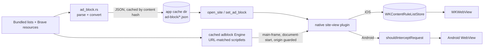

# Ad Blocking

> **Status: Implemented on iOS and Android.** Bundled EasyList, EasyPrivacy and Brave filter data feed WebKit content-rule lists. iOS also bundles Brave's iOS-specific rules. URL-matched filter-list scriptlets are registered at document start on supported native webviews. Desktop is not built. See [Verified results](#verified-results) for the exact checks; live-site ad removal is not guaranteed.

## What it does

Native content rules block requests and hide supported elements. Filter-list scriptlets also run in the page's JS realm at document start where supported; page code can observe or override them. No scriptlet grants Tauri IPC, and the app never downloads filter lists.

## Why this engine

| Option | Verdict |
|--------|---------|
| **Brave [`adblock`](https://github.com/brave/adblock-rust) crate** (Rust, MPL-2.0) | **Chosen.** Maintained: 0.13.5 released 2026-10-28, last push 2026-11-05, about 1.4M downloads. Parses ABP/uBO syntax and has a built-in converter to Safari content-blocking JSON (`content-blocking` feature). Same language as the core, no Swift dependency, converts both bundled lists in about 0.2 s in a release build. |
| AdGuard `SafariConverterLib` (Swift) | Not adopted. A second language and dependency for the same output; its license is believed to be GPL-3.0 **[INFERENCE: not checked this session]**, which the undecided project license ([roadmap](./roadmap.md#open-questions)) should not be committed to by accident. |
| uBlock Origin / uBO Lite | Not embeddable: browser-extension APIs, not a library for a `WKWebView`. |
| Injecting a blocking script | Rejected: cannot stop network requests, runs after the page's own scripts, and is visible to the page. |

On iOS a `WKWebView` cannot intercept requests, so a matching engine at runtime (what `adblock`'s `Engine` does on Android or desktop) is not an option; WebKit's content rule lists are the only mechanism, and the converter is the part of the crate that matters here.

## How it works



- **Lists.** EasyList and EasyPrivacy provide general ad/tracker rules; Brave Specific adds Brave-authored rules and scriptlets. iOS additionally bundles Brave iOS Specific, which includes fallback YouTube rules. Each list remains separate; an iOS update test checks that every bundled list converts to non-empty output within WebKit's 150,000-rule cap.
- **Scriptlets.** `AdBlock::scriptlets_for_url` lazily builds and caches an `adblock::Engine` from the bundled filter data and Brave resource bundle. It returns scriptlets matched to the session's starting URL. Rust wraps them with main-frame and exact-origin checks; iOS registers them as a main-frame `WKUserScript` at document start. Android registers them with `addDocumentStartJavaScript` when supported, and skips them otherwise. The global switch controls registration; recipe scripts remain separate.
- **Ids.** A list's id is `openmedia-<name>-<16 hex of SHA-256(converter revision + list text)>`. A new list version or a new converter revision gives a new id; nothing is invalidated by hand. `CONVERTER_REVISION` in `ad_block.rs` must be bumped when the `adblock` crate is upgraded.
- **Conversion runs once per version.** `AdBlock::rule_lists` writes `<id>.json` to `<app cache>/ad-block/` only if it is missing and deletes files of older versions. It runs on a blocking thread (`spawn_blocking`) because the first run parses several megabytes.
- **Compilation runs once per version too.** iOS asks `WKContentRuleListStore` for the id first and reads the JSON file only on a miss. Compiled lists persist in WebKit's store. The page opens while missing lists compile in the background, so its first load may be unblocked; later navigation uses the compiled rules. Rust converts lists at launch (`lib.rs`).
- **Subdomains.** The converter emits bare domains for element-hiding rules (`example.org##.ad`). WebKit matches a bare `if-domain` only against that exact host, so `include_subdomains` prefixes `*`; without it most domain-specific hiding rules would be inert on `www.` hosts. Checked on macOS WebKit (see roadmap decision log).
- **The setting.** `adBlock` in `library.json`, on by default; files saved before it existed load as on. `set_ad_block(enabled)` updates native rule lists and scriptlet registration. The native views reload active pages to apply the change; the Settings screen has the switch.
- **Android.** The same converted JSON is read by `BlockingRules` (`android/src/main/java/surf/openmedia/siteview/BlockingRules.kt`) and matched in `shouldInterceptRequest`. WebView's URL filter is an unanchored regex; each rule is a `java.util.regex.Pattern`, with domain and resource conditions interpreted against the top document. Scriptlets are independent of request interception and require AndroidX document-start support.
- **Failure.** If blocker data cannot be built or a native list fails, browsing remains available and the failure is reported; `set_ad_block` does not persist a failed setting.

## What it cannot do

Filter conversion and scriptlet resources cover only supported parts of the upstream lists. This is not Brave Browser parity:

- Unsupported procedural cosmetic filters, `$redirect`, resource replacement, `$removeparam`, `$csp`, and scriptlet names missing from the bundled Brave resource set do not run. Only default, zero permissions are used; privileged scriptlets are disabled.
- **First-party and in-stream ads are not guaranteed to be blocked.** Brave iOS Specific includes a YouTube `googlevideo.com` fallback rule, but that rule is narrow; same-origin ad delivery and site changes can bypass filter rules. The YouTube recipe still hides companion/promoted page slots, not video ad playback.
- Scriptlets match the session's starting URL. They are main-frame and origin guarded, but are not re-matched for same-origin navigation within that session.
- Android without document-start support gets network/CSS filtering but no blocker scriptlets.
- Anything past WebKit's per-list rule cap.

## Updating the lists

```bash
scripts/update-blocklists.sh
cargo test --manifest-path src-tauri/Cargo.toml ad_block
```

Lists change only with an app release. Runtime updates would add a network destination and need an [invariant 1](../../AGENTS.md) decision. EasyList/EasyPrivacy are dual-licensed (CC BY-SA 3.0 and GPLv3); Brave data is MPL-2.0. See `blocklists/README.md`.

## Not built

- Per-site allowlist ("off on this site"). The only control is the global switch.
- Desktop ad blocking is not implemented; the desktop site view does not receive these rules or scriptlets.
- Counting blocked requests. WebKit does not report matches for content rule lists.
- Optional extra lists (cookie banners, annoyances).

## Verified results

Runs on an iPhone 17 Pro Max simulator (iOS 26.5) with the real app and a local fixture page over `http://localhost` (temporary `NSAllowsLocalNetworking`, since removed). The page loads a Google Analytics script, an AdSense script, its own script, and an element with id `ad_banner`, then posts what happened to a local server.

| Check | Result |
|-------|--------|
| Both real lists compile in WebKit and persist in the app's content rule store | Yes (macOS WebKit: 2.1 s and 1.8 s; iOS simulator: stored lists of about 26 MB and 20 MB) |
| Blocking on: the analytics and AdSense scripts fail to load, the page's own script loads, `#ad_banner` is `display: none` | Yes |
| `set_ad_block(false)` reloads the open page unblocked, `set_ad_block(true)` blocks it again | Yes, with timers in a temporary shell patch calling the command; the Settings switch itself was **not** tapped |
| First open with nothing cached | Worked: about 14 s from launch to the fixture's report in a debug build, which includes app start, debug-build conversion, compiling both lists, the page load and the page's own 3 s delay. A device and a release build were not measured |
| A changed list gets a new id; the old JSON file and the old stored list are removed | Yes, with planted stale entries in both places |
| A list WebKit rejects (corrupt JSON): the page still loads, the other list still blocks, the shell shows "Ad blocking is partly off: a filter list could not be loaded." | Yes (banner seen by eye on a screenshot) |
| A bare `if-domain` matches only its exact host; `*domain` matches the host and subdomains | Yes on macOS WebKit with `om.localhost` and `www.om.localhost`. Not re-run on iOS |
| `cargo test` (app and plugin), `clippy -D warnings`, `cargo fmt --check`, `yarn ts:check`, `lint`, `format:check`, `test` | Pass locally |

**This PR's checks:** `cargo test --manifest-path src-tauri/Cargo.toml ad_block` (11 passed, including Brave iOS rule conversion and YouTube fallback conversion); Android `BlockingRulesTest`; `yarn tauri ios build --debug --target aarch64-sim --no-sign --ci`; updater syntax and bundled-data validation.

**Not verified:** real-site ad removal, including YouTube in-stream ads; physical-device behavior; Settings interaction by hand; adblock performance/memory on a device; an updater download cycle. The simulator build proves compilation, not live-site filtering.
