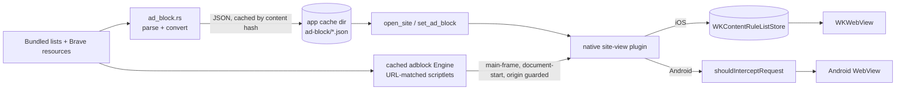

# Ad Blocking

> **Status: Implemented on iOS and Android.** Bundled EasyList, EasyPrivacy, uBlock, Brave, AdGuard Mobile and Peter Lowe filter data feed six WebKit content-rule lists. iOS also bundles Brave's iOS-specific rules. URL-matched filter-list scriptlets and a link cleaner are registered at document start on supported native webviews. Desktop is not built. See [Verified results](#verified-results) for the exact checks; live-site ad removal is not guaranteed.

## What it does

Native content rules block requests and hide supported elements. Filter-list scriptlets also run in the page's JS realm at document start where supported; page code can observe or override them. No scriptlet grants Tauri IPC, and the app never downloads filter lists.

## Why this engine

| Option | Verdict |
|--------|---------|
| **Brave [`adblock`](https://github.com/brave/adblock-rust) crate** (Rust, MPL-2.0) | **Chosen.** Maintained: 0.13.5 released 2026-10-28, last push 2026-11-05, about 1.4M downloads. Parses ABP/uBO syntax and has a built-in converter to Safari content-blocking JSON (`content-blocking` feature). Same language as the core, no Swift dependency, converts both bundled lists in about 0.2 s in a release build. |
| AdGuard `SafariConverterLib` (Swift) | Not adopted. A second language and dependency for the same output; its license is believed to be GPL-3.0 **[INFERENCE: not checked this session]**, which the undecided project license ([roadmap](./roadmap.md#open-questions)) should not be committed to by accident. |
| uBlock Origin / uBO Lite | Not embeddable: browser-extension APIs, not a library for a `WKWebView`. |
| Injecting a blocking script | Rejected: cannot stop network requests, runs after the page's own scripts, and is visible to the page. |

On iOS a `WKWebView` cannot intercept requests, so a matching engine at runtime (what `adblock`'s `Engine` does on Android or desktop) is not an option; WebKit's content rule lists are the only mechanism, and the converter is the part of the crate that matters here.

## How it works



- **Lists.** Fourteen sources, bundled unmodified (see `blocklists/README.md`): EasyList and EasyPrivacy (general ads and trackers); uBlock filters, Privacy, Badware risks, Resource abuse (uBlock Origin's own lists, which catch what EasyList misses and add malware and scam hosts); Unbreak and Quick fixes (exceptions, see below); Brave Specific, Brave Firstparty, Brave Firstparty Regional and Brave Firstparty CNAME (first-party-served trackers and CNAME-cloaked hosts, which a list of third-party rules cannot see); AdGuard Mobile Ads and Peter Lowe's host list (mobile ad networks). iOS additionally bundles Brave iOS Specific, which includes fallback YouTube rules. A test checks that every group converts to between 1,000 and 150,000 rules, WebKit's cap.
- **Groups.** WebKit applies an exception (`ignore-previous-rules`) only to rules in the same content-rule list, so an Unbreak list compiled by itself would override nothing. Sources are therefore converted in six groups (`easylist`, `easyprivacy`, `ublock`, `brave`, `brave-cname`, `mobile`) and the exception lists (uBlock Unbreak and Quick fixes, about 1,300 exceptions) ride in every group. Their few blocks are duplicated, which is harmless. Before, the exceptions inside one list never reached another list's blocks.
- **Scriptlets.** `AdBlock::scriptlets_for_url` lazily builds and caches an `adblock::Engine` from the bundled filter data and Brave resource bundle. It returns scriptlets matched to the session's starting URL. Rust wraps them with main-frame and exact-origin checks; iOS registers them as a main-frame `WKUserScript` at document start. Android registers them with `addDocumentStartJavaScript` when supported, and skips them otherwise. The global switch controls registration; recipe scripts remain separate.
- **Ids.** A group's id is `openmedia-<group>-<16 hex of SHA-256(converter revision + the text of each of its lists)>`. A new list version or a new converter revision gives a new id; nothing is invalidated by hand. `CONVERTER_REVISION` in `ad_block.rs` must be bumped when the `adblock` crate is upgraded.
- **Conversion runs once per version.** `AdBlock::rule_lists` writes `<id>.json` to `<app cache>/ad-block/` only if it is missing and deletes files of older versions. It runs on a blocking thread (`spawn_blocking`) because the first run parses several megabytes.
- **Compilation runs once per version too.** iOS asks `WKContentRuleListStore` for the id first and reads the JSON file only on a miss. Compiled lists persist in WebKit's store. The page opens while missing lists compile in the background, so its first load may be unblocked; later navigation uses the compiled rules. Rust converts lists at launch (`lib.rs`).
- **Subdomains.** The converter emits bare domains for element-hiding rules (`example.org##.ad`). WebKit matches a bare `if-domain` only against that exact host, so `include_subdomains` prefixes `*`; without it most domain-specific hiding rules would be inert on `www.` hosts. Checked on macOS WebKit (see roadmap decision log).
- **The setting.** `adBlock` in `library.json`, on by default; files saved before it existed load as on. `set_ad_block(enabled)` updates native rule lists and scriptlet registration. The native views reload active pages to apply the change; the Settings screen has the switch.
- **Android.** The same converted JSON is read by `BlockingRules` (`android/src/main/java/surf/openmedia/siteview/BlockingRules.kt`) and matched in `shouldInterceptRequest`. WebView's URL filter is an unanchored regex; each rule is a `java.util.regex.Pattern`, with domain and resource conditions interpreted against the top document. Scriptlets are independent of request interception and require AndroidX document-start support.
- **Failure.** If blocker data cannot be built or a native list fails, browsing remains available and the failure is reported; `set_ad_block` does not persist a failed setting.

## Link cleaning

`blocklists/openmedia-link-cleaner.js` runs with the scriptlets, in the main frame at document start on every page. When the user follows a link (a `click` or `auxclick`, captured before the page's own handlers) it rewrites that link's `href`:

- removes tracking query parameters (`fbclid`, `gclid`, `mc_eid` and others, Brave's `query-filter`, everywhere; Brave's `clean-urls`, only on the sites that list them, for example Facebook's `__tn__`, `set` and `source`);
- replaces a redirect-tracker address with the page it leads to (Brave's `debounce`: a destination in a query parameter, in base64, or in the path). Rules Brave ties to a user preference (leaving AMP pages) are not applied. At most three hops, and only `http(s)` destinations.

Rust (`link_clean.rs`) validates the three JSON files and puts them in front of the script as `window.__openmediaLinkRules`; the script deletes that global before the page can run. It never navigates, clicks or requests anything, and no IPC is reachable from it. It does not touch an address typed in the shell, a server redirect, or navigation the page's own script starts. Tested in `src/shared/linkCleaner.test.ts` against the bundled data.

> Recipes have the same primitive as data: a [`prune` rule](./recipe-format.md#the-prune-rule) removes items from the JSON of the page's own same-origin `fetch`/`XMLHttpRequest` responses (the `json-prune` idea, but a declarative recipe rule with an off switch, not a scriptlet). The ad-blocking scriptlets here stay in the filter lists; `prune` is for the content a user chooses to remove from a feed.

## YouTube ads

Why the earlier setup left a black screen: the ad **media** come from the same `googlevideo.com` hosts as the video, so the only network rule that can hit them (Brave iOS Specific, `ctier=L`) leaves the player holding an ad it can never play. The uBlock Origin scriptlets that Brave's lists use to remove the ad from the player response (`json-prune`, `set`, `trusted-replace-xhr-response`) were also inert: the bundled Brave resource bundle holds only Brave's own scriptlets, and a rule naming a scriptlet the engine does not have injects nothing. Android bundles no YouTube rules at all.

`blocklists/openmedia-specific.txt` names one scriptlet, `openmedia-youtube-ads`, for `youtube.com` hosts; `ad_block.rs` registers its code (`openmedia-youtube-ads.js`) as an engine resource. In the page's main world it:

- deletes `adPlacements`, `playerAds` and `adSlots` from every player response, so no ad is scheduled and nothing is left to block (`JSON.parse`, the `ytInitialPlayerResponse` and `ytInitialData` globals, `fetch` and `XMLHttpRequest` on `/youtubei/v1/`);
- drops ad tiles from feed, search and watch-next data (`adSlotRenderer`, `promotedSparklesWebRenderer`, ... see the file) and ad entries from the Shorts sequence (`reelWatchEndpoint.adClientParams.isAd`);
- runs a watchdog every 500 ms: while the player has `.ad-showing` it mutes the video and seeks to its end; after about 3 s it reloads the same video once, which fetches a pruned player response. It never clicks anything.

`scriptlets_for_url` also matches the other forms of the starting host (`example.com`, `www.`, `m.`), each under its own exact-origin guard: a phone is redirected from the bare host to `m.`, and the start URL's origin alone would leave every scriptlet inert after that.

Sources for the target keys: uBlock Origin `filters/filters.txt` and `quick-fixes.txt` (`json-prune`, `json-prune-fetch-response ... reel_watch_sequence`, `json-edit-fetch-response ... get_watch`), Brave iOS Specific (the same keys). **Not verified:** on a device against live YouTube ads; the scriptlet's logic is covered by `src/shared/youtubeAds.test.ts` against recorded-shape JSON only, and the `XMLHttpRequest` path and the watchdog have no test.

## What it cannot do

Filter conversion and scriptlet resources cover only supported parts of the upstream lists. This is not Brave Browser parity:

- Unsupported procedural cosmetic filters, `$redirect`, resource replacement, `$removeparam`, `$csp`, and scriptlet names missing from the bundled Brave resource set do not run. Only default, zero permissions are used; privileged scriptlets are disabled.
- **First-party and in-stream ads are not guaranteed to be blocked.** YouTube is handled by `blocklists/openmedia-youtube-ads.js` (see [YouTube ads](#youtube-ads)); it removes ads by editing the page's data, which Google can change at any time. An ad stitched into the video stream itself is only skipped by a watchdog that mutes it and seeks to its end, which needs the video to have loaded.
- Scriptlets match the session's starting URL. They are main-frame and origin guarded, but are not re-matched for same-origin navigation within that session.
- Android without document-start support gets network/CSS filtering but no blocker scriptlets.
- Anything past WebKit's per-list rule cap.

## Updating the lists

```bash
scripts/bump-blocklist-pins.sh      # optional: pins to each upstream's latest commit
scripts/update-blocklists.sh
cargo test --manifest-path src-tauri/Cargo.toml --lib -- ad_block:: link_clean::
yarn vitest run src/shared/linkCleaner.test.ts
scripts/check-blocklists-webkit.sh  # macOS: compiles every converted group with WebKit
```

Lists change only with an app release. The scheduled **Blocklists** workflow (`.github/workflows/blocklists.yml`) does the five steps weekly and opens a pull request when the data changed; it merges and releases nothing, and the same checks run on every pull request that touches the lists. Runtime updates would add a network destination and need an [invariant 1](../../AGENTS.md) decision. EasyList/EasyPrivacy are dual-licensed (CC BY-SA 3.0 and GPLv3); Brave data is MPL-2.0; uBlock and AdGuard lists carry their own licences (see `blocklists/README.md`).

`scripts/check-blocklists-webkit.sh` is the only check that uses WebKit's own compiler: one rule it rejects fails a whole list on a device, and Rust cannot see that. On an Apple-silicon Mac the six groups compile in about 8 s in total (EasyList and EasyPrivacy 2.5 s each). A device is slower, and the compile happens once per list version; until it finishes the first page loads unblocked.

## Not built

- Per-site allowlist ("off on this site"). The only control is the global switch. This is the escape hatch for breakage and the main thing to add before more lists (cookie banners, annoyances) are bundled; each site already has its own web view, so it is a settings, reload and translation change rather than an engine one.
- Optional extra lists: EasyList Cookie / Fanboy Cookiemonster (about 23,000 hiding rules), AdGuard Base (121,000 rules, mostly EasyList again, 14 MB compiled), Hagezi Pro (237,000 host rules, over the cap) and Brave Social (blocks Facebook and LinkedIn sign-in embeds) were measured and left out.
- Scriptlets are matched once, for the starting host (and its `www.` and `m.` forms), in the main frame. uBlock's own scriptlets (`set-constant`, `json-prune`, ...) are not in the bundled resource bundle, so rules naming them inject nothing; bundling them means shipping GPLv3 code and needs a licence decision.
- On Android a rule is matched by `BlockingRules.kt`, not by the `adblock` engine, so `$important`, `$badfilter` and `$redirect` resources are not honored there.
- Procedural cosmetic filters (`:has-text`, `:xpath`), `$removeparam` filters from the lists (Brave's link-cleaning data covers the common parameters instead), CNAME uncloaking at the DNS level, and desktop.
- Counting blocked requests. WebKit does not report matches for content rule lists.

## Verified results

Runs on an iPhone 17 Pro Max simulator (iOS 26.5) with the real app and a local fixture page over `http://localhost` (temporary `NSAllowsLocalNetworking`, since removed). The page loads a Google Analytics script, an AdSense script, its own script, and an element with id `ad_banner`, then posts what happened to a local server.

| Check | Result |
|-------|--------|
| Both real lists compile in WebKit and persist in the app's content rule store | Yes (macOS WebKit: 2.1 s and 1.8 s; iOS simulator: stored lists of about 26 MB and 20 MB) |
| Blocking on: the analytics and AdSense scripts fail to load, the page's own script loads, `#ad_banner` is `display: none` | Yes |
| `set_ad_block(false)` reloads the open page unblocked, `set_ad_block(true)` blocks it again | Yes, with timers in a temporary shell patch calling the command; the Settings switch itself was **not** tapped |
| First open with nothing cached | Worked: about 14 s from launch to the fixture's report in a debug build, which includes app start, debug-build conversion, compiling both lists, the page load and the page's own 3 s delay. A device and a release build were not measured |
| A changed list gets a new id; the old JSON file and the old stored list are removed | Yes, with planted stale entries in both places |
| A list WebKit rejects (corrupt JSON): the page still loads, the other list still blocks, the shell shows "Ad blocking is partly off: a filter list could not be loaded." | Yes (banner seen by eye on a screenshot) |
| A bare `if-domain` matches only its exact host; `*domain` matches the host and subdomains | Yes on macOS WebKit with `om.localhost` and `www.om.localhost`. Not re-run on iOS |
| `cargo test` (app and plugin), `clippy -D warnings`, `cargo fmt --check`, `yarn ts:check`, `lint`, `format:check`, `test` | Pass locally |

**Earlier PR's checks:** `cargo test --manifest-path src-tauri/Cargo.toml ad_block` (11 passed, including Brave iOS rule conversion and YouTube fallback conversion); Android `BlockingRulesTest`; `yarn tauri ios build --debug --target aarch64-sim --no-sign --ci`; updater syntax and bundled-data validation.

**Not verified:** real-site ad removal, including YouTube in-stream ads; physical-device behavior; Settings interaction by hand; adblock performance/memory on a device; an updater download cycle. The simulator build proves compilation, not live-site filtering.

**Coverage PR's checks:**

| Check | Result |
|-------|--------|
| All six groups compile with macOS WebKit (`scripts/check-blocklists-webkit.sh`) | Yes: easylist 8.2 MB JSON in 2.5 s, easyprivacy 6.3 MB in 2.5 s, brave-cname 2.0 MB in 0.9 s, mobile 1.7 MB in 0.9 s, ublock 1.2 MB in 0.9 s, brave 1.1 MB in 0.6 s |
| Converted rules block known trackers and spare common libraries | Yes, `ad_block::tests::known_trackers_are_blocked_and_common_libraries_still_load`, which evaluates the shipped JSON (regex, resource type, load type, page domain, `ignore-previous-rules`) with a model of WebKit's matching, **not WebKit itself** |
| Each group carries the Unbreak exceptions | Yes (`every_group_carries_the_breakage_exceptions`) |
| Link cleaner against the bundled Brave data | Yes, 16 vitest cases, including one that exercises the first include pattern of every strip rule |

**Not verified in the coverage PR:** the link cleaner and the larger rule set in the iOS simulator, on a device or on Android; compile time and memory on an iPhone with six groups instead of two; live-site breakage from the added lists (there is no allowlist yet).
