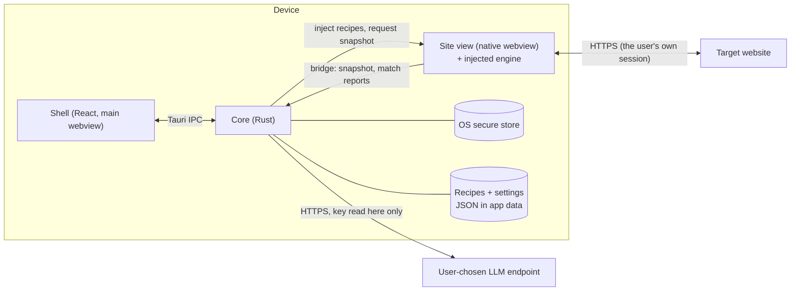
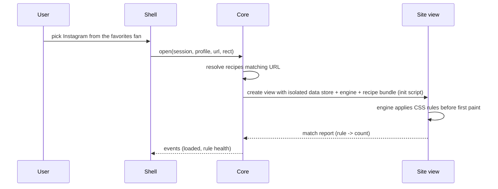
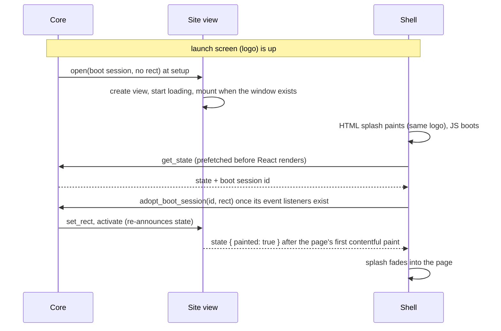

# Architecture

> **Status: Partially implemented.** The React shell, Rust core, iOS and Android native site-view plugins, BYOK assistant, hub builder and local usage controls exist. Hubs launch independent sessions for multiple sites; they do not merge site data. iOS has simulator verification; Android device/emulator behavior is unverified. macOS site views exist (debug builds run on one Mac); Windows and Linux site views, profile selection, and parts of the planned runtime remain unimplemented.

## Overview

OpenMedia has three trust zones:

| Zone | What runs there | Trust |
|------|-----------------|-------|
| **Shell** | Our React UI in the Tauri main webview | Trusted. Has IPC to Rust. |
| **Core** | Rust (`src-tauri`): recipe store, validation, AI providers, secret store, site-view control | Trusted. Only place that sees API keys. |
| **Site view** | A separate native webview showing a third-party site, plus our injected engine | **Hostile.** Arbitrary remote code. No IPC except the bridge. |



## Why a native webview, not an iframe or a proxy

- **iframe:** Instagram, YouTube, X and most targets send `X-Frame-Options` / `frame-ancestors`. They refuse to render in a frame.
- **Proxy/rewriting server:** would be a backend (rejected), and would route the user's credentials through it.
- **Native webview loading the real site directly:** the user logs in to the real origin, cookies stay in the webview's own store, and we inject our engine into the page. SocialLite's FAQ describes the same user-visible shape (the account opens inside its own app with a session cookie kept on device); that it is an injected webview is inferred, not stated by them (see [Prior Art](./prior-art.md)).

## Components

### SiteView (Rust API; native iOS/Android and macOS child-webview implementations)

The Rust API is shared; Swift on iOS and Kotlin on Android provide the native web views, and macOS uses Tauri child webviews. Windows and Linux currently return `DesktopUnsupported`.

| Operation | Purpose |
|-----------|---------|
| `open(session, profile, url, rect?)` | Create a site view for a new session with the profile's isolated data store, below the transparent shell, and show it. Earlier sessions stay alive, hidden. Without a `rect` the view fills the screen under the top safe area until the shell reports one; this is how Core opens the start page before the shell has loaded ([Launch](#launch)) |
| `activate(session)` / `close(session)` | Show a live session without reloading it / tear one down. The shell decides which to close |
| `set_rect(rect)` / `set_interactive_regions(rects)` | The shell owns layout: where the page draws, and which regions of the screen belong to the shell rather than the page |
| `navigate`, `back`, `forward`, `reload` | Browser controls on the visible session |
| `set_recipes(bundle)` | Push the resolved recipe bundle for this site; engine re-applies live |
| `request_snapshot(opts)` | Ask the engine for a pruned, redacted DOM snapshot |
| `events` | Stream: navigation, title, load state, match reports, picker results |

- **macOS:** a Tauri child webview per session, beside the shell rather than under it; see [The macOS site view](./platform-support.md#the-macos-site-view).
- **Windows and Linux:** no site view; the plugin returns `DesktopUnsupported`.
- **Mobile** (iOS/Android): the in-repository Tauri plugin hosts a native `WKWebView` / Android `WebView` and exposes the shared API. See [Platform Support](./platform-support.md).

### Recipe store (Rust)

Recipes are JSON files in the app data dir, one per recipe. **Every recipe the project ships is compiled into the app and nothing is downloaded**: 142 official site recipes and the community recipes merged into `recipes/community/` are embedded by `build.rs` and offered by the recipe library ([Recipe Library and Sharing](./recipe-library.md)); *Add* copies one into the data dir, so a fresh install has none added until the user picks some (see Onboarding below). The first 19 official recipes have site-specific rules tested against their fixtures; 123 later additions use generic cookie, ad and app-banner rules with synthetic, not live-captured, fixtures. There are no forks. Origins are only `user`, `ai` and `imported`; page-specific AI changes write a separate `custom.<domain>` recipe beside an installed one, and hub proposals save as `custom.hub-<slug>`. The assistant never edits an installed recipe. Hubs store 2–6 launcher tabs, while the shell opens every tab in the ordinary independent site-session model. The recipe library's subject-category tags come from `recipes/categories.json`. See [Recipe Format](./recipe-format.md).

### AI service (Rust)

Rust has Anthropic and OpenAI-compatible adapters (including Gemini, OpenRouter, OpenCode Zen, Ollama, LM Studio, and compatible endpoints). The same BYOK configuration supports structured patch generation and bounded tool calls for the read-only hub builder over the bundled recipes. Requests run in Rust, so the key never enters a webview. See [AI Assistant](./ai-assistant.md).

### Secret store (Rust)

The in-repository `SecretStore` uses the iOS Keychain and Android Keystore-backed storage. Desktop credential stores are not implemented. See [Security](./security.md).

### Recipe page script (Rust-generated)

Rust compiles the implemented recipe subset (`hide`, `css` and `script`) into a self-contained document-start script in `src-tauri/src/recipes/compile.rs`. It matches the page URL, injects a stylesheet and, for `script` rules, runs each script once after `DOMContentLoaded` (the scripts are embedded as raw function expressions, never evaluated from strings, so a page CSP does not stop them). Which scripts a recipe may carry is decided by `src-tauri/src/recipes/script_policy.rs` ([Script Policy](./script-policy.md)). This is not a standalone TypeScript engine; SPA observers and the richer runtime described in [Site Runtime](./site-runtime.md) remain design work.

### Shell (React)

One full-screen page with floating controls ([UI Design](./ui-design.md)): tap opens addresses or AI requests, hold opens favorites, Incognito, Usage, History and Settings. Current pages and history entries have favorite actions; Settings edits and reorders the list in collapsed disclosures. Incognito (`src/features/incognito`, `src-tauri/src/incognito.rs`) swaps in a second favorites set and a second set of recipe choices after a biometric check that only Rust can raise; the on/off state lives in Rust memory and is never saved. Daily per-site and per-part warnings and limits reuse foreground usage accounting (`src/features/stats`, `src-tauri/src/usage.rs`); native iOS shields enforce exhausted sessions without changing other sites, while a part over its limit only stops counting and says so. The shell owns session lifetime; native code opens, shows, closes and pins each session to its domain. AI requests run in Rust with redacted payload preview, validated proposals and explicit acceptance. HubBar switches among tabs of an accepted hub; each opens as an ordinary site session. Keys stay in the secure store.

## Core data flows

### Open a site and apply recipes



### Onboarding (Design)

First launch shows the guide, then a step "What do you need in quick access?" that lists the official recipes for the current platform (`onboarding_options`, from the bundled set), and a step explaining the recipe library. `onboarding_apply` adds the selection through the same path as `library_install` and **replaces the favorites** with exactly the installed picks' homepages when at least one install succeeds (4 free, 6 with Pro: 5 or 6 without Pro is `pro-required`, more than 6 or a repeat is an error; picks that are not official options for this platform or fail to install are returned in `failed`; names are cut to 20 characters), then the shell calls `complete_onboarding`. Failed picks are reported and skipping is always allowed. See [UI Design](./ui-design.md#onboarding) and [Recipe Library and Sharing](./recipe-library.md).

### Launch

The page does not wait for the shell. Core opens the start page (the last page, else the first favorite) from its own `setup`, in parallel with the shell's boot; the shell adopts it once it can listen for its events.



If the start page could not be opened, `adopt_boot_session` opens the address as `open_site` would. Details and measurements: [Platform Support](./platform-support.md#startup).

### Ask the AI to customize

```mermaid
sequenceDiagram
  participant U as User
  participant S as Shell
  participant C as Core
  participant V as Site view
  participant L as LLM endpoint
  U->>S: "remove the reels tab and suggested posts"
  S->>C: ai_customize(request, view)
  C->>V: request_snapshot
  V-->>C: pruned snapshot
  C->>C: redact; show preview to user if enabled
  C->>L: prompt + schema + snapshot (key read here)
  L-->>C: structured rule patch
  C->>C: validate against recipe schema
  C->>V: apply as ephemeral preview
  V-->>C: match report
  alt a rule matched nothing
    C->>L: feedback, one repair round (max 2)
  end
  C-->>S: preview ready
  U->>S: accept
  S->>C: save recipe
```

## Persistence

| Data | Location | Notes |
|------|----------|-------|
| Favorites, settings, history and provider configuration | `<app_data>/library.json` | No API keys |
| Usage records and policies | `<app_data>/usage.json` | Local data |
| User recipes, imported recipes and added library recipes | `<app_data>/recipes/` | The bundled recipes are embedded in the binary; *Add* writes a local copy here |
| API keys | OS secure storage | iOS Keychain; Android Keystore-backed plugin; never returned to the shell |
| Site cookies/storage | Native webview profile store | Android behavior is not device-verified |

There is no cross-device sync. There is no way to move a recipe between devices as text; a recipe that should reach everyone is shared as a pull request ([Recipe Library and Sharing](./recipe-library.md)).

## Current stack

| Layer | Implementation |
|-------|----------------|
| App framework | Tauri v2 |
| Shell | React 19, TypeScript, Vite, Tailwind CSS v4 |
| State | Zustand |
| Core | Rust; `serde`, `reqwest`, `thiserror`, `keyring`, `adblock` |
| Native site view and billing | In-repository Tauri plugins: Swift/iOS and Kotlin/Android |
| Tests | Vitest and Rust tests |
| Package manager | Yarn 1 |

The current dependencies are listed in `package.json` and `src-tauri/Cargo.toml`. The AI and recipe formats evolve with the implementation; this page does not describe planned crates or generated schema tooling as present.

## Repository layout

```text
src/
  app/                  React app state and composition
  features/             UI grouped by feature (AI, web, settings, stats, ...)
  shared/               Shared frontend state, IPC helpers, and components
  i18n/                 Localized UI messages
src-tauri/
  src/                  Rust app, commands, recipes (incl. `share.rs`), `recipes/bundled.rs` (the embedded library), `share/` (GitHub share client), AI, storage, usage
  plugins/
    tauri-plugin-siteview/  Swift and Kotlin native site views
    tauri-plugin-billing/   Store billing adapters
  gen/                  Generated Apple and Android native projects
recipes/
  official/             Official recipes, embedded in the app (validated and fixture-tested)
  community/            Community recipes merged from pull requests (validated, embedded)
  fixtures/             DOM fixtures per site
scripts/official-recipes.mjs  Prints the SQL that publishes recipes/official/ (operator)
blocklists/              Bundled EasyList and EasyPrivacy files
assets/store/            Store listing artwork and source captures
docs/wiki/               Source-controlled wiki, synced to GitHub Wiki
```

## See Also

[Recipe Format](./recipe-format.md) · [Site Runtime](./site-runtime.md) · [AI Assistant](./ai-assistant.md) · [Security](./security.md) · [Platform Support](./platform-support.md)
