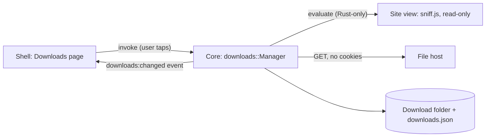

# Downloads

> **Status: Implemented, desktop engine verified by tests; no device verification.** The engine, the list, the page sniffer, naming masks, rules and batch descriptors are covered by Rust tests (against a loopback HTTP server) and Vitest. Nothing here has been run on an iPhone, an Android device or in a built desktop app. Platform notes below say what is expected to differ.

OpenMedia saves files from the web through its own manager instead of leaving each platform's web view to do it. The manager is in Rust (`src-tauri/src/downloads/`); the shell lists and controls it (`src/features/downloads/`).

## What it does

| Feature | Behavior |
|---------|----------|
| **List** | Queued, running, paused, finished, failed and cancelled downloads with progress, speed and time left. Pause, resume, cancel, retry, open, show in folder, remove, clear finished. The list survives a restart. |
| **Segments** | A file the server serves with `Range` and that is at least 2 MiB is fetched on up to 8 connections (Settings, default 4). A server without `Range` gets one connection. |
| **Pause and resume** | With `Range` support a pause keeps each connection's position in the `.part` file; resume asks only for what is missing (with `If-Range` on the `ETag` or `Last-Modified` seen at the start; a changed file fails with a message instead of a corrupt file). Without it a pause starts the file over. A download running when the app closed comes back paused when its bytes are still there, failed otherwise. |
| **Queue** | Three downloads run at once; the rest wait. |
| **Notifications** | A banner in the shell when a download finishes or fails, and a count on the downloads button for what ended since the list was last opened. These are in-app only; the app asks for no system notification permission. |
| **Preview** | Images up to 8 MiB and the first 16 KiB of plain text show in the list. Audio, video, archives and the rest open in the device's own app (**Open**). There is no in-app audio, video or archive viewer: the shell's CSP has no `media-src`, and widening it was not worth a preview. |
| **Page sniffer** | *This page* lists the links, images, video and audio of the page in front (`` and `srcset`, lazy-load attributes, `<picture>`, `<video>`, `<audio>`, inline `url(...)` backgrounds, links to files, and the page's own resource requests), with filters by kind and by regular expression, select all, and one tap to download the selection. Image rows show a thumbnail and can be enlarged; video, audio and other rows show their kind (the shell cannot play remote media). Streams (`.m3u8`, `.mpd`) are not listed. Only the top document is read; cross-origin frames are not. |
| **Batch descriptors** | One address per line; `[001-020]`, `[1-100:5]` (step) and `[a-e]` stand for ranges, several groups multiply, other brackets stay literal. At most 500 addresses at once. |
| **Naming masks** | `{filename} {name} {ext} {title} {page} {site} {host} {date} {time} {kind} {n}` and `{n:3}` (zero-padded), with `/` starting a folder. Dates are UTC. A mask without `{filename}` or `{ext}` keeps the file's extension. |
| **Rules** | A rule matches by site (the domain or a parent), file kind and a regular expression over the address, and sets a folder (tokens allowed) and a mask. The first enabled match wins; no match uses the general mask. |

## Where it fits

- **No new reach for a site.** `sniff.js` runs through the plugin's Rust-only `evaluate` (isolated world), exactly like the color picker. It only reads the document and returns data; the page gets no channel, command, event or capability. A page can neither start a download nor see the list.
- **Every download starts from the shell on a tap** (a selection in *This page*, an address in *Add*). Nothing downloads on its own; the sniffer runs when the tab opens or on *Scan again*, and reads only.
- **What comes back from the page is hostile.** `sniff::parse` keeps `http` and `https` addresses up to 2048 characters, a kind from a closed set, labels with control characters removed, at most 1000 entries, and drops the rest.
- **Names are hostile too.** The server's `Content-Disposition`, the address, the link text and the page title all feed file names. Each piece is cleaned to one safe path component (no separators, no `..`, no control or bidirectional-override characters, no Windows reserved names, at most 120 characters); folders come from `/` in masks and rules only. A file always lands under the download folder, never beside or above it. A name already in use gets ` (1)`, ` (2)`; the `.part` file is created with `create_new`, so two downloads cannot take one name.
- **Requests carry no cookies and no credentials.** The manager's HTTP client has no cookie store and sends a Safari user agent and, when the download came from a page, that page's origin as `Referer`. A link that only works inside a signed-in session answers with the server's refusal (`HTTP 401/403`). Reusing the web view's session would put the profile's cookies into Rust and is out of scope here.
- **Incognito.** A download started while incognito is on is marked private: never written to `downloads.json`, and removed (a running one cancelled) when incognito ends.

## Storage

`downloads.json` in the app data directory: `{ version, settings, records }`, written atomically on each state change and about every two seconds while running. History keeps the newest 500 finished downloads. Files go to the folder set in Settings, else the device's downloads folder from Tauri's path resolver (`download_dir`), else `<app data>/downloads`.

Settings: the button on the floating button's fan (on by default, and switchable off here), the general mask, connections per file (1 to 8), the folder (a full path), and up to 50 rules. Rule masks and folders, the general mask and regular expressions are validated in Rust before saving (regular expressions with a compile-size limit; the `regex` crate matches in linear time).

## Commands

All are app commands for the shell; none is reachable from a site view.

| Command | Purpose |
|---------|---------|
| `downloads_state`, `downloads_set_settings` | Read the list and settings; save settings |
| `downloads_add`, `downloads_add_text` | Start downloads from chosen items; from typed text with descriptors |
| `downloads_pause`, `downloads_resume`, `downloads_cancel`, `downloads_remove`, `downloads_clear_finished` | Control |
| `downloads_open`, `downloads_reveal`, `downloads_preview` | The finished file |
| `downloads_sniff` | Read the page in front (async: the iOS plugin answers from the main thread) |

Event `downloads:changed` carries one download's new state.

## Platform notes

- **macOS.** A link the page itself marks as a download (`Content-Disposition: attachment`) still goes through WebKit, which saves it to Downloads and shows it in Finder (see [Platform Support](./platform-support.md#downloads)). The manager does not see those; use the sniffer or *Add* to bring one into the list.
- **Windows and Linux.** There is no site view, so *This page* explains that and the other tabs work.
- **iOS and Android.** The engine is the same Rust code. The default folder is whatever `download_dir` resolves to in the app's sandbox, **not** a user-visible Downloads folder, and *Show in folder* is unsupported by the opener plugin there; *Open* hands the path to the system. Both are unverified.

## Decisions

| Decision | Why | Revisit if |
|----------|-----|-----------|
| Own engine over `reqwest` and a `.part` file, not the web view's download | Pause, resume, segments, naming and a list are not available from WebKit or the Android WebView | A platform's web view download API grows them |
| Segments only when `Range` is honoured, and the size is known | A wrong guess corrupts files; the opening request is `Range: bytes=0-`, and its answer decides | A server mis-reports; add a hash check |
| No cookies | Putting the profile's cookies into Rust widens invariant 8's blast radius | Users need signed-in downloads: add a per-profile cookie handoff behind a decision |
| Dates in UTC | No time-zone database in the build; adding one for a file name was not worth it | A local-time token is asked for |
| In-app notifications only | A system notification permission is a new prompt on every platform | Background downloads on mobile |
