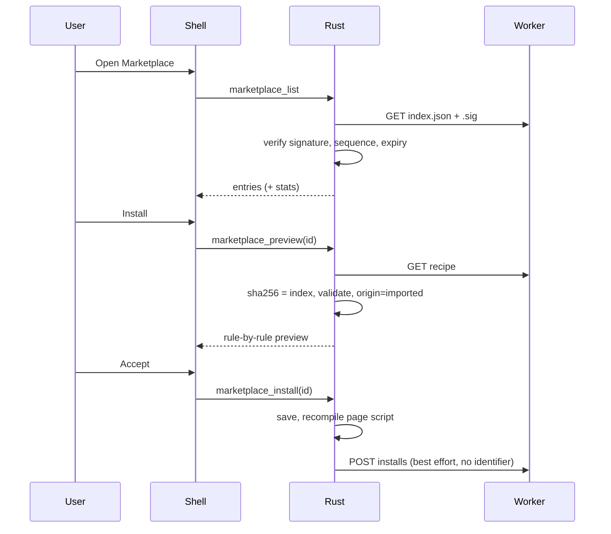

# Recipe Marketplace and Sharing

> **Status: Partially implemented (v1, automatic publishing) plus Design (v2: tags, official channel, ratings, comments, Pro gates).** Device side (`src-tauri/src/recipes/share.rs`, `src-tauri/src/catalog/`, `src-tauri/src/share_commands.rs`, shell UI in `src/features/marketplace/`) is implemented. The Worker lives in [`openmedia-worker`](https://github.com/skepjandi/openmedia-worker); the scheduled publisher is deployed, and production publication is verified for `market.official.messages-hub` (signed catalog sequence 86). The remaining v2 marketplace features are not production-verified; see [Verified results](#verified-results). Decision record: [Roadmap](./roadmap.md#decision-log), 2026-11-10.

Two ways to move recipes between people:

1. **Export / import** of a recipe or bundle, as text. No network. **Import is free; export needs Pro** (client-side gate, see [Pro gates](#pro-gates)).
2. **Marketplace**: an automatically published catalog on Cloudflare. Browse, install, rate and read comments are free; submit and comment need Pro.

Both end in the same place: a recipe with `origin: imported`, reviewed rule by rule before anything applies.

**The app ships no recipes.** The 18 site recipes are the **official** marketplace recipes (`market.official.<site>`, source files in `recipes/official/`); a fresh install has none until the user installs some, usually during [onboarding](./ui-design.md#onboarding). Status: Design.

## Tags, official and community

The catalog tag contract is implemented in Rust, the Worker and the landing page; see the current allowed set and hub behavior below. Ratings, comments and Pro-gated actions retain their individual status notes.

Every recipe carries platform tags; the signed catalog entry may also carry the `hub` content tag. Allowed index tag set: `mobile`, `desktop`, `official`, `community`, `hub`.

- **Platform tags** (`mobile`, `desktop`; one or both) are **inside the recipe JSON** as `tags` ([Recipe Format](./recipe-format.md#top-level-fields)). They are required; the Rust validator and the Worker's validator must stay equal.
- **The origin tag** (`official` or `community`) is **never inside a recipe**. The Worker adds it to the index entry.
- **The `hub` tag** is added by the Worker exactly when the recipe contains `hub` tab metadata; it supplements the recipe's platform tags and the origin tag.
- **Official** means published by us. **Community** means anything a user uploads; the origin is forced by the Worker's channel, so an upload cannot claim to be official. Community submissions with an id starting `market.official.` are rejected. A recipe's tag is a label, not a trust level: all recipes install through the same verified path (signature, SHA-256 pin, Rust validation, rule-by-rule review, `origin: imported`).
- The app's Marketplace page filters on origin, platform and hub tags; official recipes for the current platform come first. The landing page shows the same badges and filters.

### AI marketplace tools

The AI hub builder can search the app's already-verified signed catalog and read recipes by id. These are read-only operations: search returns a bounded set of public listing metadata, and recipe reads verify the signed catalog hash before returning public recipe data. A read is limited to ids surfaced by a search in that same build. This is not a new marketplace endpoint and does not publish anything; the user submits an accepted hub separately through the existing submission flow.


### Official mode (Worker)

Status: Design. The publisher parses a row with `channel = 'official'` in an **official mode**; everything else, and every `POST /v1/submissions` (which has no way to ask for it), is parsed as community. Official mode skips only the word screening of selectors (password, login, payment words) and the page-wide-hide heuristics (`body`, `html`, `*`); the recipes are written by the maintainers, inserted by an operator, and legitimately select things such as a login link. All structural validation still applies: schema, keys, tags, limits, the CSS declaration whitelist, selector shape and the https homepage rule. Anything in `channel` that is not exactly `official` is treated as community.

### Official publishing path (operator)

Status: Production D1 insertion and scheduled publication verified for `market.official.messages-hub` on 2026-11-11 (signed catalog sequence 86). Other official recipe publication paths remain unverified.

Official recipes live in `recipes/official/*.json` in the app repo (`origin: "user"` in the file, `meta.author: "OpenMedia"`; the app sets `imported` on install). They are still validated and fixture-tested by `cargo test`, but are **not** compiled into the app. `scripts/official-recipes.mjs` prints a SQL file that, for every file, inserts a `submissions` row (`channel='official'`, status `held`, `release_at=0`, validated, `recipe_json`) and an `owners` row with `token_hash='official'`, a value that never matches a real token hash, so nobody can take over an official id. It also prints the `wrangler d1 execute` command to run it. The next scheduled promotion publishes them. This path is an operator action, not a public endpoint. Platform tags of each official recipe come from its fixtures: `desktop` if `recipes/fixtures/<site>/desktop-*.html` exists, `mobile` if any non-desktop fixture exists.

## Threat model

Rows marked *v2* are Design; the controls are specified in this page, not yet verified end to end.

| Threat | Control |
|---|---|
| A malicious recipe hides a phishing warning or breaks a site | Automatic validation in the Worker before anything is stored; Rust validation again on the device; rule-by-rule review before first apply; `script` rules refused everywhere ([Recipe Format](./recipe-format.md#trust-levels)). **No policy can prove a recipe is benign**: a `hide` rule can match a selector that also covers a security banner, so the app shows every rule instead of a verdict |
| Someone edits files on the server or in transit | Catalog index is signed with Ed25519; the public key is compiled into the app; each recipe is pinned in the index by SHA-256 |
| The Worker or Cloudflare account is compromised | The signing key is a Worker secret, so a compromised Worker can sign its own entries. The app still pins every recipe by SHA-256 in the signed index, re-validates the recipe in Rust and shows every rule before the first apply: the signature proves the catalog came from the Worker, not that a recipe is safe |
| Old signed index replayed to hide a takedown | Monotonic `sequence` (device refuses lower) and `expiresAt` |
| Bad recipe already installed | Signed `revoked` list; the app disables an installed recipe whose `(id, sha256)` appears in it |
| A file import claims `user` or `ai` to bypass the `hide`/`css`-only restriction | Import ignores the file's `origin` and sets `imported` before validation |
| A file import overwrites a marketplace or custom recipe | File imports always get the id prefix `imported.`; `market.` ids are accepted only from the verified catalog path |
| Submission flood | Size cap, per-IP rate limit, a daily cap on submissions, held entries expire |
| Fake install counts | Counts are display-only, approximate, rate limited, and never used for any trust decision |
| Takeover of someone's recipe id | First submitter gets a random edit token (returned once; only its hash is stored on the server). A new version of an id needs the token. The device keeps the token in `catalog-state.json`, not the secret store (that store is keyed per AI provider). A leaked token lets someone submit a new version of that id; it goes through the same automatic validation and the same 14-day hold, so it can never skip the hold |
| *v2* Claiming an official id, or posing as official | The origin tag is added by the Worker from the submission channel and is never read from the recipe; `market.official.*` ids are refused for community submissions; official owner rows carry a hash that matches nothing |
| *v2* Rating manipulation (ballot stuffing, sock puppets) | Ratings are display-only and never used for ranking trust or publishing. Controls: one rating per identity per recipe (re-rating replaces); an identity's ratings are stored but **not counted until its first sight is 24 hours old**; at most 20 different recipes rated per identity per rolling 24 hours (checked atomically in the insert); per-IP rate limits (`RATING_LIMITER` 10 per 60 s for the landing path, `APP_RATING_LIMITER` 3 per 60 s for the app path); a smoothed average (prior mean 3.5, prior weight 5) that is `null` until 5 counted ratings; limiter keys use the IPv6 /64 prefix. The landing path needs a Cloudflare Turnstile token. **The app path cannot render Turnstile, so anyone who sets `X-Client: app` and a device token can script it.** The limits bound the damage; they do not prevent it |
| *v2* Comment abuse (spam, links, harassment, contact details) | Pro-only posting, enforced by the Worker; text rules (length, no links or contact details, no control characters); per-identity and per-recipe rate and quantity limits; duplicate refusal; three distinct reports hide a comment, but a report counts toward that threshold only from an identity first seen at least 24 hours ago or verified Pro within the Pro cache window, and one identity writes at most 10 reports a day; a user can block a commenter locally. **Report-to-hide can still be abused by someone with several aged device tokens** (sybils), so it can hide a legitimate comment. A person does not review comments (see [Store policy](#store-policy)) |
| *v2* Pro verification abuse (faking Pro to upload or comment) | The Worker asks RevenueCat's REST API; the app's claim is never trusted. If RevenueCat is unreachable or unconfigured the Worker answers 503, never fail-open. **The RevenueCat app user id is a bearer secret for Pro actions**: anyone who obtains another user's id can upload and comment as that Pro user. The id stays on the device and is sent only on Pro actions over HTTPS, and the Worker stores only its hash, but the Worker cannot tell the owner from someone holding the id |
| *v2* RevenueCat id handling and cost abuse | The app user id is format-checked before any RevenueCat call (RevenueCat's `GET /v1/subscribers/{id}` **creates unknown subscribers**), and only anonymous ids `^\$RCAnonymousID:[0-9a-f]{32}$` are accepted; results are cached in D1 (15 min Pro, 2 min not Pro); a per-IP limiter (`PRO_LIMITER` 20 per 60 s, counted only on a cache miss) and a global budget of 60 RevenueCat lookups per minute sit in front (over budget: `503`, cached answers still served); the Worker stores only `sha256(id)` and never logs or echoes ids or keys; errors are fixed strings |
| *v2* Turnstile unavailable or bypassed | A rating from the landing page without a verified token is refused (403); with `TURNSTILE_SECRET_KEY` unset the Worker answers 503 instead of skipping the check. Turnstile is a bot speed bump, not identity |

## Export and import

A bundle is JSON:

```json
{ "openmediaBundle": 1, "recipes": [ { "schema": 1, "id": "…", "…": "…" } ] }
```

- **Export:** one recipe or all the user's own. Copy as text.
- **Import:** paste text. Limits: 1 MiB total, 20 recipes, 256 KiB per recipe. Rust parses with `deny_unknown_fields`, sets `origin: imported`, drops `forkedFrom`, prefixes the id with `imported.`, then runs the normal validation (broad `match` refused, selectors and declarations whitelisted).
- **Review:** the shell shows each recipe's sites, options and every rule (type and selector). Nothing is saved until the user accepts. Accept re-validates from the original text.
- **No key, cookie or setting ever appears in an export.**

## Marketplace

One host, set at build time with `OPENMEDIA_MARKET_URL` (a bare `https://` address; plain `http://` only to `localhost` or a loopback IP, in debug builds only) and `OPENMEDIA_CATALOG_KEYS` (`keyId:base64 public key`, comma-separated to trust several). The public key is the public half of the Worker's signing key; only the Worker holds the private half, as a Cloudflare secret. Both variables are read by `src-tauri/build.rs` from the environment or `.env`, like the billing keys. Without them the Marketplace row is hidden (`marketplace_status.available` is false); Import and export still work. The app talks to it only on user action: opening the Marketplace, installing, reporting, submitting, rating, and reading or posting comments. HTTPS only, no redirects, no cookies, every response size-capped, errors that never repeat what the server said. In v1 the device sent no identifier; v2 sends a random device token and, on Pro actions only, the RevenueCat app user id ([Privacy](#privacy)).

### Pieces

| Piece | Where | Does |
|---|---|---|
| Worker | separate repo [`skepjandi/openmedia-worker`](https://github.com/skepjandi/openmedia-worker) (Cloudflare Workers) | Serves the signed catalog from R2, accepts submissions and reports, counts installs. It checks every submission automatically, holds the accepted ones for 14 days and publishes them itself, signing the catalog with its own secret key. No admin endpoints |
| R2 bucket | binding `CATALOG` | `index.json`, `index.json.sig`, `recipes/<id>/<version>.json`, `pending/<submission>.json` |
| D1 database | binding `DB` | `submissions`, `owners` (edit-token hashes), `installs`, `reports`; v2 adds `identities`, `ratings`, `comments`, `comment_reports`, `pro_checks` and `submissions.channel` / `submissions.submitter` (migration `0003_community.sql`, additive) |
| App client | `src-tauri/src/catalog/` | Fetch, verify, download, check hash, validate, preview, install |

The Worker repo implements the API below; **this page is the contract**. A change to the API, the index format or the submission limits is made here first, then in both repos. The Worker's name and author limits (60 characters) and its `hide`/`css`-only rule filter must stay equal to the Rust validator's, or the Worker would accept what the device refuses.

### API (all under `/v1`)

| Request | Response |
|---|---|
| `GET /index.json`, `GET /index.json.sig` | Signed catalog (below). Cached at the edge |
| `GET /recipes/<id>/<version>.json` | The exact bytes the index hashes. Immutable, cached |
| `GET /upcoming.json` | `{ "recipes": [{ "id", "name", "version", "author", "summary", "hosts", "submittedAt", "releaseAt", "recipe": { "options", "rules" } }] }`. Dates are Unix seconds. Only the submissions currently held appear (the newest 500 at most), and no edit token is ever in the answer. **v2:** each entry also has `tags` (platform tags plus origin, always `community` here) |
| `POST /submissions` `{recipe, summary, editToken?}` | `202 {submissionId, editToken?}`. `editToken` only on first claim of an id. An accepted submission is held for 14 days and then published automatically. **v2:** requires header `X-Pro-User` and a Pro identity: not Pro `402`, missing or malformed id `401`, RevenueCat unreachable or unconfigured `503` (never fail open); at most 5 submissions per identity per rolling 24 hours and 200 per day across everyone (`429`); both caps are checked atomically in the insert |
| `POST /reports` `{id, version, reason}` | `202`. Reason is one of a fixed list |
| `POST /recipes/<id>/installs` (empty body) | `204`. Increments one counter |
| `GET /stats.json` | `{ "<id>": installs }`. Unsigned, display only |
| *v2* `GET /ratings.json` | `{ "ratings": { "<recipeId>": { "average": number \| null, "count": number } } }`. Public, edge-cached 300 s. `count` counts only ratings from identities older than 24 hours; `average` is a smoothed mean (prior mean 3.5, prior weight 5) rounded to one decimal, `null` while `count` < 5 |
| *v2* `POST /recipes/<id>/rating` `{stars: 1..5, turnstileToken?}` | Header `X-Device-Token` (43 characters, base64url of 32 random bytes) required. Landing path: device token plus `turnstileToken`, verified with Cloudflare siteverify (`TURNSTILE_SECRET_KEY`; unset is `503`; no client address is sent). App path: device token plus `X-Client: app`, no Turnstile. Neither is `403`. The recipe must be currently published (`404` otherwise). Re-rating replaces. At most 20 different recipes rated per identity per rolling 24 hours. Per-IP limiters: `RATING_LIMITER` (10 per 60 s) landing, `APP_RATING_LIMITER` (3 per 60 s) app |
| *v2* `GET /recipes/<id>/comments.json` | `{ "comments": [{ "id", "commenter", "text", "createdAt" }] }`, newest first, at most 50, only status `visible`. Public, edge-cached 60 s; `404` for a recipe that is not published. `commenter` is the first 10 hex characters of `sha256("commenter:" + identityHash)`, stable across recipes so the app can block it |
| *v2* `POST /recipes/<id>/comments` `{text}` | Header `X-Pro-User`; verified Pro, else `402`. `201 {id}`. Rules in [Abuse rules](#abuse-rules) |
| *v2* `DELETE /comments/<id>` | Header `X-Pro-User`. Only the author's identity (no Pro re-check) sets the status to `removed`; `204`. Anyone else `403` |
| *v2* `POST /comments/<id>/report` | Header `X-Device-Token` or `X-Pro-User`. One report per identity per comment (repeat is an idempotent `204`). Three distinct reporting identities set the status to `hidden`, counting only reporters first seen at least 24 hours ago or verified Pro recently; at most 10 report writes per identity per day |

Submissions are validated in the Worker by a strict policy (size, JSON, `schema`, `market.` id shape, no `script` rule, and the same limits the Rust validator applies). **v2:** the index entry adds `tags` (platform tags plus the origin tag) and `homepage` (the recipe's `meta.homepage` when it is an `https` URL, else `null`); the app's index entry type rejects unknown fields, so the app and Worker change together. The Worker accepts a homepage only if it is an `https` URL without credentials or backslash and its real hostname is covered by the recipe's own `match` patterns (the same rule as the Rust validator). Ids starting `market.official.` are refused for community submissions. `meta.notes` is capped at 4000 characters in both Rust and the Worker. Cross-origin: reads may be made from `https://openmedia.surf` and `https://www.openmedia.surf` (CORS is added after the edge cache, so every read is cached whatever `Origin` it carries); the only cross-origin write is the rating `POST` from those two origins (`X-Client` is deliberately not an allowed header, so a web page cannot take the app path); every other write carrying a foreign `Origin` is refused with `403`. The device's `X-Pro-User` and `X-Device-Token` headers are described under [Privacy](#privacy).

**A submission that fails any check is rejected before it is stored**: nothing is written to R2 or D1. The device validates the recipe again when it is downloaded, and shows every rule before the first apply. The Worker's check is a policy, not a proof: it cannot tell a recipe that hides a security banner from one that does not.

### Signed index

```json
{
  "format": 1,
  "keyId": "k1",
  "sequence": 42,
  "issuedAt": 1794268800,
  "expiresAt": 1796860800,
  "recipes": [
    { "id": "market.youtube-calm", "name": "…", "version": "1.2.0", "author": "…",
      "summary": "…", "hosts": ["youtube.com"], "sha256": "<hex>", "size": 1834,
      "publishedAt": 1794268800, "featured": false,
      "tags": ["desktop", "mobile", "community"], "homepage": "https://www.youtube.com/" }
  ],
  "revoked": [ { "id": "market.old", "sha256": "<hex>" } ]
}
```

`index.json.sig` is standard base64 of the Ed25519 signature over `"openmedia-catalog-v1\n" || <exact index.json bytes>`. Times are Unix seconds. The private key is a Worker secret (`SIGNING_KEY`, PKCS#8, base64) and `SIGNING_KEY_ID` names it in the index; it never leaves Cloudflare and is never written into a build. The app holds a list of `(keyId, public key)`, so a key can rotate with an app release. It checks the signature against each trusted key **before** parsing the index, then requires the index's `keyId` to name the key that verified.

The app refuses an index that: fails verification, has a `keyId` that does not name the verifying key, has an unknown `format`, is past `expiresAt`, or has a `sequence` lower than the last one it accepted (stored in `catalog-state.json`). It also refuses an index with duplicate ids, ids not under `market.`, a `sha256` that is not 64 lowercase hex characters, or entry text that cannot be shown safely.

### Install flow



### Onboarding install

Status: Design. On first launch the app asks what the user wants in quick access and lists the **official** recipes for the current platform (`onboarding_options`: official tag, current platform tag, non-null `homepage`, from the verified index). `onboarding_apply` accepts at most 4 recipes (6 with Pro) and installs each through the same verified path as `marketplace_install`, then **replaces the favorites** with exactly the installed picks (each recipe's homepage; names cut to 20 characters). When no install succeeds the favorites are left alone. A pick that is not an official option for this platform, or that fails to install, is returned in `failed` and gets no favorite; more than 6 picks or a repeat is an error, and 5 or 6 picks without Pro is `pro-required`. Skipping is always allowed and works offline. The same flow explains the marketplace. See [UI Design](./ui-design.md#onboarding).

### Submit flow

**v2: uploading needs Pro**, checked in Rust before any request (`marketplace_submit` calls `require_pro()`) and again by the Worker with RevenueCat. The user picks one of their own recipes and a one-line summary. Rust sends it. The Worker checks it against that validation policy and rejects it before anything is stored if it fails. **No person reviews it** (an open store-policy risk, see [Store policy](#store-policy)). An accepted submission is held: it appears at once in the public Upcoming feed (`GET /v1/upcoming.json`) with `releaseAt = submittedAt + 14 days`, and a scheduled Worker promotion publishes the matured entries and signs the new catalog. Until an update publishes, the current published version stays available. A new version of a published id needs the edit token.

Existing D1 submissions migrate to the held state and start a fresh 14-day clock at migration time, so a pending entry that was never checked is never published silently.

### Ratings

Status: Design. Any user can give 1 to 5 stars, one per identity per recipe; re-rating replaces. The identity is `sha256` of the random device token (table `identities`, kind `device`; a Pro identity is kind `pro`). The app shows the average and count from `ratings.json` fetched with the listing (a failed fetch just shows no rating) and remembers the user's own rating in `catalog-state.json`; the landing page shows the same numbers and can rate behind Cloudflare Turnstile. **Ratings are display-only: never used for ranking trust, featuring or publishing.** They are bounded by identity age (24 hours), per-identity caps, per-IP limiters and smoothing; they are not manipulation-proof, and the app path, which cannot use Turnstile, can be scripted by anyone who sets `X-Client: app`.

### Comments

Status: Design. Everyone reads comments (in the app and on the landing page, plain text). **Posting is Pro-only and happens only in the app.** The user can delete their own comment, report any comment, and block a commenter. Blocked commenter ids (`^[0-9a-f]{10}$`) are stored in `catalog-state.json` and filtered out in Rust, so the shell never sees them. A comment's `commenter` id is derived from the author's Pro identity hash and is not reversible to the RevenueCat id.

### Abuse rules

Status: Design (each is required to have a Worker test; none has been run against a deployed Worker).

| Surface | Rule | Failure |
|---|---|---|
| Comment text | Trimmed length 1 to 280 Unicode scalars after NFKC normalisation (fullwidth forms become plain ones; the normalised text is stored); no control or format characters, no invisible direction overrides, no run of 4 or more combining marks; nothing that looks like a link or contact: `://`, `www.`, `@`, a bare domain with a common TLD, a spelled-out form (`dot com`, `[at]`), or a run of 7 or more digits (spaces, dots, dashes and brackets between digits count). The link filters run with combining marks removed. The TLD list is explicit and short, so this is a heuristic that can be written around | `400` |
| Duplicates | The same identity may not post the same text (lower-cased, whitespace and punctuation collapsed) within 24 hours | `409` |
| Comment rates | At most 3 comments per identity per rolling 24 hours, at most 1 per 60 seconds, at most 2 per identity per recipe (removed ones count); re-checked atomically in the insert | `429` |
| Comment target | The recipe must be currently published | `404` |
| Reports | One report per identity per comment; 3 distinct reporters hide the comment, counting only reporters first seen at least 24 hours ago or verified Pro recently; at most 10 report writes per identity per day | idempotent `204` / `429` |
| Submissions | Pro identity required; at most 5 per identity per rolling 24 hours, 200 per day across everyone, 5 per minute per IP (`WRITE_LIMITER`) | `402` / `401` / `503` / `429` |
| Ratings | 1 to 5; recipe published; at most 20 different recipes rated per identity per rolling 24 hours; a rating by an identity first seen under 24 hours ago is stored but not counted; limiters `RATING_LIMITER` 10/60 s (landing, with Turnstile) and `APP_RATING_LIMITER` 3/60 s (app) | `404` / `429` / `403` |
| Pro checks | Id format `^\$RCAnonymousID:[0-9a-f]{32}$` checked first; result cached in D1 (15 minutes Pro, 2 minutes not Pro); `PRO_LIMITER` 20 per 60 s per IP on cache misses; global budget of 60 RevenueCat lookups per minute (503 over budget; cached answers still served) | `401` / `429` / `503` |
| Comment writes | `COMMENT_LIMITER` 3 per 60 s per IP (posting, deleting and reporting). IPv6 clients are limited by their /64 prefix; the key is hashed and never stored | `429` |

There are no abuse rules beyond this list: for example, no all-caps filter. **Operator takedown** of a comment is editing D1 (`UPDATE comments SET status = 'removed' …`, optionally for everything one `identity_hash` wrote); of a recipe, inserting a `revocations` row, which the next publisher run puts in the signed `revoked` list; there is no public admin API. The Worker's README has the commands. The scheduled handler also prunes `pro_checks` older than 7 days, spent budget rows and identities older than 90 days that have no rating, comment or report.

### Pro gates

| Action | Gate | Where enforced |
|---|---|---|
| Upload a recipe (`marketplace_submit`) | Pro | **Worker** (RevenueCat check) and Rust `require_pro()` |
| Post a comment | Pro | **Worker** and Rust `require_pro()` |
| Delete own comment | Not Pro-gated: the Worker checks the author's identity, so a lapsed Pro user can still delete their own comment | Worker |
| Export recipes (`export_recipes`) | Pro | **Client-side only** (Rust `require_pro()`): export touches no server, and this repository is open source, so a fork can remove it |
| Onboarding quick-access slots | 4 free, 6 with Pro | Client-side only (Rust, same limit as favorites) |
| Import, browse, install, rate, read comments, report, block, delete own comment | Free | n/a |

On a platform with no store (Windows, Linux) the billing plugin returns no app user id, so the Worker-gated actions (upload, comment) are unavailable there; export and the client-side gates are bypassed on those platforms like every other Pro feature ([Paywall](./paywall.md)).

### Privacy

- The device sends nothing until the user opens the Marketplace. Then it fetches the signed catalog; visible recipe rows may also fetch a site's favicon directly from its first valid HTTPS host if that icon is not cached. That site sees the device's connection and IP address. Installs send the recipe id only. Submissions send what the user chose to share.
- No account and no analytics SDK. In v1 there was also no device id; **v2 adds the device token and the Pro-action id listed below**. The Worker stores no IP address, and Workers Logs stay off. Cloudflare itself necessarily sees the connection (the same is true of any host); the store privacy label and privacy page must say so.
- **v2 identifiers (a change from v1).** The marketplace now receives two identifiers, so "no identifier" is no longer true of this host:
  - **RevenueCat app user id** (anonymous, from the billing plugin's `app_user_id()`), sent in the header `X-Pro-User` **only on submit, post a comment and delete a comment**. Never on listing, installing, rating or reporting (a report sends the device token). The Worker uses it to ask RevenueCat whether the user is Pro and stores **only `sha256(id)` in hex** (never the id), never logs or echoes it. The shell never sees it. Rust does not send it where the platform has no store.
  - **Random device token** (32 random bytes, base64url, 43 characters), created lazily in `catalog-state.json` and sent in `X-Device-Token` on rating and on reporting (a rating also sends `X-Client: app`); the Worker stores `sha256(token)` as the identity. It is not derived from the hardware or the user, can be reset by clearing app data, and is never sent with install counts or catalog fetches.
  - The Worker still stores **no IP address**; rate limiters use Cloudflare's rate-limit bindings.
- **RevenueCat** receives the id from the Worker's server-side lookup (it learns nothing new about the user from OpenMedia beyond that the id was checked) [INFERENCE: RevenueCat's own handling is not documented here].
- **Landing page:** rating on the website uses Cloudflare Turnstile (a Cloudflare challenge script and frame load from `challenges.cloudflare.com`) and a device token stored in the browser's `localStorage` key `openmedia.device`.
- The user can turn install counting off on the Marketplace page (`marketplace_set_counting`). The install is then not reported.

### Store policy

A catalog of user-submitted content counts as user-generated content for App Store and Play review. **This design does not claim to satisfy either store's rules.** Automatic schema and risk checks are not reliable detection of harmful or deceptive intent; the public 14-day hold is not moderation.

- **Apple, App Store Review Guideline 1.2 (User-Generated Content)** (<https://developer.apple.com/app-store/review/guidelines/#user-generated-content>): a method to filter objectionable material before posting, report content with timely responses, block abusive users and publish contact details. The Worker rejects invalid recipe structures before storage, but those checks cannot reliably detect objectionable or deceptive recipes.
- **Google Play, User Generated Content policy** (<https://support.google.com/googleplay/android-developer/answer/9876937>): users must accept terms before uploading; the service needs robust, effective, ongoing moderation, in-app reporting and blocking controls. This design has no upload-time terms acceptance or human moderation; v2 adds only device-local blocking of commenters.

What exists today: an in-app report action (`POST /reports`), removal of a recipe through the signed revocation list and through editing D1 and the catalog by an operator, and a public 14-day window in which a report can arrive before a recipe is published.

**v2 adds user-generated comments, so this risk grows.** Comments are free text from users, which both policies treat as user-generated content more directly than a recipe's selectors. Against the four things the stores ask for, v2 is **partially addressed, not satisfied** (Design, not built or reviewed by either store):

| Store expectation | v2 status |
|---|---|
| Filter objectionable content before posting | **Partial.** Server-side limits (length, no links or contact details, no control characters, duplicate and rate limits, Pro-only posting). These are not a reliable detector of insults, hate or abuse |
| Report with timely responses | **Partial.** In-app report; three distinct reports hide a comment automatically. Nobody responds to reports |
| Block abusive users | **Partial.** A user can block a commenter on their own device. The block is local; it does not remove the comment for others |
| Published contact | **Partial.** The operator's contact is on the privacy page and in the store listing [INFERENCE: confirm it is present before submitting] |
| Human moderation | **Absent.** No person reviews recipes, comments or reports; operator takedown is editing D1 |

Google Play's policy also expects terms to be accepted before upload; the app has no upload-time terms acceptance.

**Open risk.** The stores may reject this design: automated checks cannot reliably screen objectionable content, human moderation is absent, and blocking is device-local. Re-read both policies before submitting; the design intentionally has no human approval step. Do not describe the marketplace as moderated.

### Cost (estimates, Cloudflare list prices checked 2026-11-10)

Recipes are a few KB, so storage is negligible. Assumptions: 4 catalog opens and 5 installs per monthly active user per month; Worker requests dominate.

| Monthly active users | Worker requests / month | D1 writes / month | Plan | Estimate |
|---|---|---|---|---|
| 100k | about 1.3M | about 0.5M | Free tier covers it (100k requests/day, 100k D1 writes/day) | $0, or $5 for headroom |
| 1M | about 13M | about 5M | Workers Paid ($5 incl. 10M requests, 50M D1 writes) | about $6–10 |

**v2 changes (not re-estimated):** ratings, comments, reports, identity rows and Pro-check caches add D1 writes per active user, and every Pro action can add one RevenueCat REST call (cached 15 minutes for Pro and 2 minutes otherwise, behind `PRO_LIMITER`). The table above covers catalog opens and installs only; it was **not** recomputed for v2 and RevenueCat REST API limits and pricing for this call were not checked. Rating and comment reads are edge-cached (300 s and 60 s).

Sources: Workers, D1 and R2 pricing pages. Egress is free on R2 and D1. The cost is infrastructure only: there is no person in the loop, and the 14-day hold adds one stored row and one scheduled promotion per submission.

## Verified results

2026-11-10 pre-automation baseline, verified locally on a Mac. The maintainer later reported the original Worker and Cloudflare resources deployed; this branch's automation is not production-verified.

- **App repo, full contract:** `yarn verify` passed (`ts:check`, `lint`, `format:check`, `suffix:check`, 302 Vitest tests incl. every locale's keys; `cargo fmt --check`, `cargo clippy --workspace --all-targets -D warnings`, 238 app tests, 29 siteview tests). The curator CLI and its 43 tests were removed afterwards; the app and siteview counts above are the ones that remain.
- **Shell UI:** the new screens are type-checked and linted but **not rendered or driven** on a device, a simulator or in a browser.
- **Worker:** its own 61 tests in `openmedia-worker`.
- **Wire contract, end to end, against the Worker as it was then:** the real Worker code and D1 migration run under `wrangler dev --local`, driven by the real Rust client against an index signed by the Rust signer. Confirmed: signed index verifies; a recipe download is tied to its signed entry; an index signed by another key is refused; an install is counted (the `installs` row was checked in D1; `/v1/stats.json` is edge-cached for 10 minutes, so the number lags); an unpublished id cannot be counted; a first submission returns an edit token and stores only its 64-character hash; a repeat without the token is refused; with it, it is queued and no new token is issued; a report is stored. D1 has no IP or user-agent column.

**v2 implementation tests (local):** the Worker's own test suite (335 tests, with RevenueCat and Turnstile replaced by a stub), its type check and format check; the landing page's 29 tests, its build and a headless-browser run with stubbed fetch and Turnstile; the app's Rust tests (284 app and 29 siteview tests), `clippy -D warnings`, `cargo fmt --check`, and the macOS Swift billing package build; the shell's type check, lint, format check and Vitest. Final run: `yarn verify` passed (323 Vitest tests, 284 app and 29 siteview Rust tests, clippy and fmt clean), Worker 335 tests, landing 29 tests and build. **End to end, local only:** the real Worker under `wrangler dev --local` (migrations 0001-0004, the SQL from `scripts/official-recipes.mjs`, the cron publisher) was read by the real Rust client, which verified the signed index, listed 18 official entries with tags and homepage, installed one recipe and refused an index signed by another key; rating, comment, submission, reserved-id and CORS refusals matched the contract, and the Pro actions failed closed (503) without a RevenueCat key. Not exercised: RevenueCat, Turnstile, mobile `onboarding_options`.

**v2 not verified:** the iOS and Android native `appUserId` code; anything on a device or simulator; the new screens rendered in the real app; RevenueCat REST behaviour (that the subscriber lookup creates unknown subscribers, the entitlement fields the Worker reads), Cloudflare Turnstile, the rate-limit bindings, D1 and R2 behaviour including migrations `0003_community.sql` and `0004_limits.sql` on a real database beyond the Messages Hub publication at catalog sequence 86; other v2 publication and update paths; and App Store / Play review of user comments.

**Not verified (v1):** the Worker deployment workflow; automatic publication of community submissions after the 14-day hold, the Upcoming feed and migration of existing rows to `held` (the scheduled publisher successfully promoted the official Messages Hub row); the rate-limit binding on the Workers Free plan (the Cloudflare docs do not say; the Worker's README documents a WAF rate-limiting rule as the alternative if it is unavailable); edge caching behaviour in production beyond the Messages Hub catalog entry; behaviour on iOS, Android or macOS; App Store and Play review of user-generated content.

## Not in scope

Written reviews (only star ratings and short Pro comments exist), comment editing, replies and threads, a public admin or moderation API, ranking by rating. Accounts, payments for recipes, paid creators, `script` rules, any ranking that uses install counts for trust. **Out of scope in the other direction too:** there is no manual approval queue, no moderator and no signed-by-a-person step, and no public moderation or takedown endpoint — a takedown is an operator editing D1 and the catalog.

## See Also

[Recipe Format](./recipe-format.md) · [Security](./security.md) · [Roadmap](./roadmap.md)
