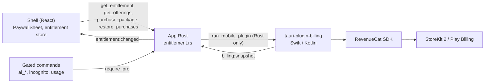

# Paywall

> **Status: Implemented in source for iOS, Android and macOS.** Billing and Android host code are unbuilt; real store purchases, restore and device behavior are unverified. The macOS Swift package builds and links, and the Mac app starts locked until the store answers; no purchase was made. Windows and Linux bypass Pro (no store).

OpenMedia has no accounts and no backend of ours, so the paywall rests on two things: the store account (Apple ID, Google account) and RevenueCat, which turns store receipts into a single entitlement.

## What is paid

| Free, always | Pro |
|---|---|
| Opening any link or site, web search from the command bar, up to four favorites (the first four quick-access slots), history, bundled recipes and their switches, ad and tracker blocking, Settings, theme, language | All AI features (providers, keys, test, assistant, preview, accept) |
| Deleting AI providers and keys, leaving incognito, unblocking a site, recording usage | Incognito mode |
| | Usage: Stats, daily policies and limits, blocking an exhausted site |
| | Quick-access slots 5 and 6, and More favorites (a free user sees the two slots grayed out and More favorites locked) |

## Plans

| Plan | RevenueCat package | Price (store-localized, never hardcoded) | Notes |
|---|---|---|---|
| Lifetime | `$rc_lifetime` | $18.99 once | Non-consumable |
| Yearly | `$rc_annual` | $10 | Auto-renewing |
| Monthly | `$rc_monthly` | $2 | Auto-renewing, 14-day free-trial introductory offer |

All three attach to one entitlement, `pro` (`ENTITLEMENT_ID` in `src-tauri/src/entitlement.rs`), inside the RevenueCat offering `default`. The shell shows the price strings the store returns; a trial line appears only when the user is eligible (`trialDays` is not null).
On iOS the trial line is shown only when RevenueCat confirms introductory-offer eligibility. Google Play resolves eligibility at checkout and RevenueCat reports preflight eligibility as unknown on Android, so the app omits a trial badge there; Play's checkout is authoritative.

## Architecture

- **`tauri-plugin-billing`** (`src-tauri/plugins/tauri-plugin-billing`) wraps `purchases-ios` and `purchases-android`. RevenueCat has no Tauri SDK. Its methods (`configure`, `customerInfo`, `offerings`, `purchase`, `restore`) are Rust-only: no Tauri command, permission or capability exists for them, so neither the shell nor a site view can call the plugin. On macOS the same API is served by a Swift package linked into the app (`macos/`, see [Platform Support](./platform-support.md#the-macos-site-view)); Windows and Linux return `Unsupported`.
- **`entitlement.rs`** owns the state (`loading`, `free`, `pro`), resolves it in the background at launch, and exposes the commands the shell uses. It is the only place Pro is decided.
- **The gate is in Rust.** `require_pro` runs at the top of each gated command, so a UI bug cannot unlock a feature. Gated: `ai_save_provider`, `ai_set_key`, `ai_set_active`, `ai_test`, `set_ai_preview`, `ai_prepare`, `ai_send`, `ai_accept`, `unlock_incognito`, `enter_incognito`, `get_incognito_favorites`, `set_incognito_favorites`, `get_usage`, `get_usage_policies`, `set_usage_policy`, and `set_usage_blocked` when blocking. A rejected call returns the stable code `pro-required`, which the shell turns into the paywall. If Pro is lost while incognito is on, incognito is switched off.
- **Favorites limit.** `set_favorites` and `set_site_favorite` call `require_pro` when a save would grow the list past `FREE_FAVORITE_LIMIT` (4, `library.rs`; mirrored by `FREE_QUICK_ACCESS_LIMIT` in the shell). A list already longer (the five defaults, or Pro that lapsed) can still be edited, reordered and shortened, just not extended; its entries past the fourth show grayed out and do nothing but open the paywall.
- **Shell.** `src/features/paywall/` holds typed IPC wrappers, the zustand store, `PaywallSheet` and lock affordances. While entitlement is `loading`, gated actions stay blocked and open the paywall rather than risk a free access window.

## No login: how recovery works

Identity is RevenueCat's anonymous app-user ID, kept on the device. A user on a new device taps **Restore Purchases**; RevenueCat re-reads the store receipt for that Apple ID or Google account and attaches the entitlement. Set the RevenueCat project restore behaviour to **Transfer to new App User ID**, so a restore on a fresh anonymous ID takes the entitlement over.

Rules carried over from GitNotes, which has no login either and fixed these in production:

1. A restore result wins over any cached negative; a negative answer is never cached when RevenueCat had not answered.
2. Restore never grants Pro when RevenueCat is not configured (a missing or placeholder key means unconfigured; Pro stays off and the sheet says purchases are unavailable).
3. Resolving the entitlement never blocks first render. `loading` counts as locked.
4. Network failures retry three times (1 s, 3 s, 7 s); an error never downgrades a known Pro; the shell re-checks when the app returns to the foreground.
5. Restore happens only when the user taps it, never silently on launch. A cancelled purchase clears the previous error.
6. In debug builds only, `OPENMEDIA_DEV_ENTITLEMENT=pro|free` forces the result, so simulators can test both sides without the store.

## Configuration

Public SDK keys are not secrets but are kept out of the repo. `src-tauri/build.rs` reads them from the process environment or `.env` at build time:

| Variable | Purpose |
|---|---|
| `OPENMEDIA_RC_KEY_IOS` | RevenueCat public key, `appl_…` |
| `OPENMEDIA_RC_KEY_MACOS` | Optional: RevenueCat public key for the Mac app, `appl_…`; defaults to `OPENMEDIA_RC_KEY_IOS` |
| `OPENMEDIA_RC_KEY_ANDROID` | RevenueCat public key, `goog_…` |
| `OPENMEDIA_DEV_ENTITLEMENT` | Debug builds only: `pro` or `free` |
| `EXPO_PUBLIC_FORCE_ENABLE_PRO_ON_SIMULATOR` | Debug only: `true` grants Pro after native code confirms iOS Simulator or Android Emulator; ignored on physical devices and release builds. |

Store setup (App Store Connect, Play Console, RevenueCat dashboard) is described in the release checklist below.

## Release checklist

- App Store Connect: paid-apps agreement active; one subscription group with monthly ($2/month, 14-day free-trial introductory offer) and yearly ($10/year); one non-consumable lifetime product ($18.99); all attached to `pro` in RevenueCat. Suggested product IDs: `surf.openmedia.pro.monthly`, `.yearly`, `.lifetime`.
- Play Console: same USD prices and plans, with a 14-day monthly free-trial offer; lifetime is a one-time in-app product. Add all products to the RevenueCat `pro` entitlement and configure service-account credentials in RevenueCat.
- The paywall reads `VITE_PRIVACY_POLICY_URL` and `VITE_TERMS_URL`; both must be live HTTPS pages before purchases are enabled. They open through the app's normal site navigation. They are unset in `.env.example`.
- App Privacy label: RevenueCat collects purchase history and an anonymous identifier.

## Privacy and invariants

RevenueCat is the one third-party network destination added by this feature (invariant 1 in `AGENTS.md`). It receives the anonymous app-user ID, the store receipt and device/app metadata its SDK collects. It never receives page content, addresses, recipes, AI keys or snapshots. The SDK is initialised only in `tauri-plugin-billing` and only when a public key is configured.

This repository is open source, so a fork can remove the gate. The paywall is a commercial convention on official builds, not tamper-proofing.

## Verified results

Filled in by the PR that lands this page; see the matching [CHANGELOG](../../CHANGELOG.md) entry.

## See also

[Architecture](./architecture.md) · [Security](./security.md) · [Platform Support](./platform-support.md) · [AI Assistant](./ai-assistant.md)
