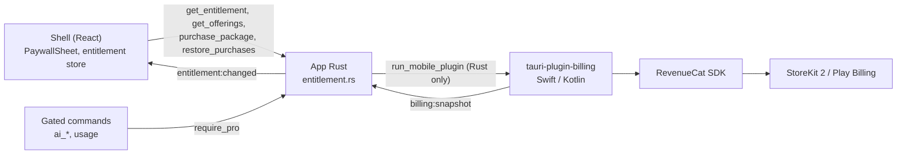

# Paywall

> **Status: Implemented in source for iOS, Android and macOS.** Billing and Android host code are unbuilt; real store purchases, restore and device behavior are unverified. The macOS Swift package builds and links, and the Mac app starts locked until the store answers; no purchase was made. Windows and Linux bypass Pro (no store).

OpenMedia has no accounts. Its one server (the share Worker, see [Recipe Library and Sharing](./recipe-library.md)) knows nothing about purchases: sharing a recipe needs no Pro, and no purchase identifier is ever sent to it. The paywall otherwise rests on two things: the store account (Apple ID, Google account) and RevenueCat, which turns store receipts into a single entitlement.

## What is paid

| Free, always | Pro |
|---|---|
| Opening any link or site, web search from the command bar, favorites (all five quick-access slots and More favorites), the bookmark button in the fan (one saved page), history, adding recipes (official and community) from the recipe library and their switches, importing recipes, sharing a recipe as a GitHub pull request, ad and tracker blocking, Settings, theme, language | All AI features (providers, keys, test, assistant, preview, accept) |
| Incognito mode, deleting AI providers and keys, unblocking a site, recording usage | Usage: Stats, daily policies and limits, blocking an exhausted site |

**Where the new gates are enforced.** The onboarding slot count: in Rust only. Sharing a recipe stays free.

**Windows and Linux.** There is no store there, so Pro is bypassed locally (above). The client-side gates are open there.

## Plans

| Plan | RevenueCat package | Price (store-localized, never hardcoded) | Notes |
|---|---|---|---|
| Lifetime | `$rc_lifetime` | $18.99 once | Non-consumable |
| Yearly | `$rc_annual` | $10 | Auto-renewing |
| Monthly | `$rc_monthly` | $2 | Auto-renewing, 14-day free-trial introductory offer |

All three attach to one entitlement, `pro` (`ENTITLEMENT_ID` in `src-tauri/src/entitlement.rs`), inside the RevenueCat offering `default`. The shell shows the price strings the store returns; a trial line appears only when the user is eligible (`trialDays` is not null).
On iOS the trial line is shown only when RevenueCat confirms introductory-offer eligibility. Google Play resolves eligibility at checkout and RevenueCat reports preflight eligibility as unknown on Android, so the app omits a trial badge there; Play's checkout is authoritative.

## Architecture

- **`tauri-plugin-billing`** (`src-tauri/plugins/tauri-plugin-billing`) wraps `purchases-ios` and `purchases-android`. RevenueCat has no Tauri SDK. Its methods (`configure`, `customerInfo`, `offerings`, `purchase`, `restore`) are Rust-only: no Tauri command, permission or capability exists for them, so neither the shell nor a site view can call the plugin. On macOS the same API is served by a Swift package linked into the app (`macos/`, see [Platform Support](./platform-support.md#the-macos-site-view)); Windows and Linux return `Unsupported`.
- **`entitlement.rs`** owns the state (`loading`, `free`, `pro`), resolves it in the background at launch, and exposes the commands the shell uses. It is the only place Pro is decided.
- **The gate is in Rust.** `require_pro` runs at the top of each gated command, so a UI bug cannot unlock a feature. Gated: `ai_save_provider`, `ai_set_key`, `ai_set_active`, `ai_test`, `set_ai_preview`, `ai_prepare`, `ai_send`, `ai_accept`, `get_usage`, `get_usage_limits`, `set_usage_limit`, `set_usage_section_limit`, and `set_usage_blocked` when blocking. A rejected call returns the stable code `pro-required`, which the shell turns into the paywall.
- **Favorites are not gated.** `set_favorites` and `set_site_favorite` never call `require_pro`; free and Pro users get the same five quick-access slots, More favorites, and onboarding picks.
- **Shell.** `src/features/paywall/` holds typed IPC wrappers, the zustand store, `PaywallSheet` and lock affordances. While entitlement is `loading`, gated actions stay blocked and open the paywall rather than risk a free access window.

## No login: how recovery works

Identity is RevenueCat's anonymous app-user ID, kept on the device. A user on a new device taps **Restore Purchases**; RevenueCat re-reads the store receipt for that Apple ID or Google account and attaches the entitlement. Set the RevenueCat project restore behaviour to **Transfer to new App User ID**, so a restore on a fresh anonymous ID takes the entitlement over.

Rules carried over from GitNotes, which has no login either and fixed these in production:

1. A restore result wins over any cached negative; a negative answer is never cached when RevenueCat had not answered.
2. Restore never grants Pro when RevenueCat is not configured (a missing or placeholder key means unconfigured; Pro stays off and the sheet says purchases are unavailable).
3. Resolving the entitlement never blocks first render. `loading` counts as locked.
4. Network failures retry three times (1 s, 3 s, 7 s); an error never downgrades a known Pro; the shell re-checks when the app returns to the foreground.
5. Restore happens only when the user taps it, never silently on launch. A cancelled purchase clears the previous error.
6. In debug builds only, `OPENMEDIA_DEV_ENTITLEMENT=pro|free` forces the result, so simulators can test both sides without the store.

## Configuration

Public SDK keys are not secrets but are kept out of the repo. `src-tauri/build.rs` reads them from the process environment or `.env` at build time:

| Variable | Purpose |
|---|---|
| `OPENMEDIA_RC_KEY_IOS` | RevenueCat public key, `appl_…` |
| `OPENMEDIA_RC_KEY_MACOS` | Optional: RevenueCat public key for the Mac app, `appl_…`; defaults to `OPENMEDIA_RC_KEY_IOS` |
| `OPENMEDIA_RC_KEY_ANDROID` | RevenueCat public key, `goog_…` |
| `OPENMEDIA_DEV_ENTITLEMENT` | Debug builds only: `pro` or `free` |

Store setup (App Store Connect, Play Console, RevenueCat dashboard) is described in the release checklist below.

## Release checklist

State as of 2026-11-10, from the App Store Connect API (read and written with an API key); Play Console and RevenueCat were not reachable from the repository.

- **App Store Connect (done):** subscription group `OpenMedia Pro` with `surf.openmedia.pro.monthly` ($1.99) and `surf.openmedia.pro.yearly` ($9.99), and the non-consumable `surf.openmedia.pro.lifetime` ($18.99), all READY_TO_SUBMIT with an en-US name. The prices are Apple's nearest price points to the planned $2 and $10. The 14-day free-trial introductory offer was missing and was added to monthly in all 175 territories. The app's privacy policy URL is set. **Still open:** a review screenshot for each product, and the paid-apps agreement and tax details if not already active.
- **Play Console (open):** the same three products (monthly with a 14-day free-trial offer; lifetime a one-time product), an upload to Internal testing, license testers.
- **RevenueCat (open):** add the products, attach all three to the `pro` entitlement, a `default` offering (current) with packages `$rc_lifetime`, `$rc_annual`, `$rc_monthly`, the Android service-account JSON, the App Store in-app purchase key, and restore behaviour "Transfer to new App User ID". The macOS app shares the iOS `appl_` key (`OPENMEDIA_RC_KEY_MACOS` overrides it); a Mac App Store build is needed to buy on the Mac ([Store Builds](./store-builds.md#mac-app-store)).
- The paywall reads `VITE_PRIVACY_POLICY_URL` and `VITE_TERMS_URL`; both must be live HTTPS pages before purchases are enabled (`https://openmedia.surf/privacy/` and `/terms/` answered 200 on 2026-11-10). They open through the app's normal site navigation.
- App Privacy label: RevenueCat collects purchase history and an anonymous identifier.

## Privacy and invariants

RevenueCat is the one third-party network destination added by this feature (invariant 1 in `AGENTS.md`). The anonymous app-user ID is never sent anywhere else. RevenueCat receives the anonymous app-user ID, the store receipt and device/app metadata its SDK collects. It never receives page content, addresses, recipes, AI keys or snapshots. The SDK is initialised only in `tauri-plugin-billing` and only when a public key is configured.

This repository is open source, so a modified copy can remove the gate. The paywall is a commercial convention on official builds, not tamper-proofing.

## Verified results

No purchase, restore or offering has been run on any platform. The Mac app starts with Pro locked (the RevenueCat SDK reached its servers and reported no offerings because none were attached yet). See the matching [CHANGELOG](../../CHANGELOG.md) entries.

## See also

[Architecture](./architecture.md) · [Security](./security.md) · [Platform Support](./platform-support.md) · [AI Assistant](./ai-assistant.md)
