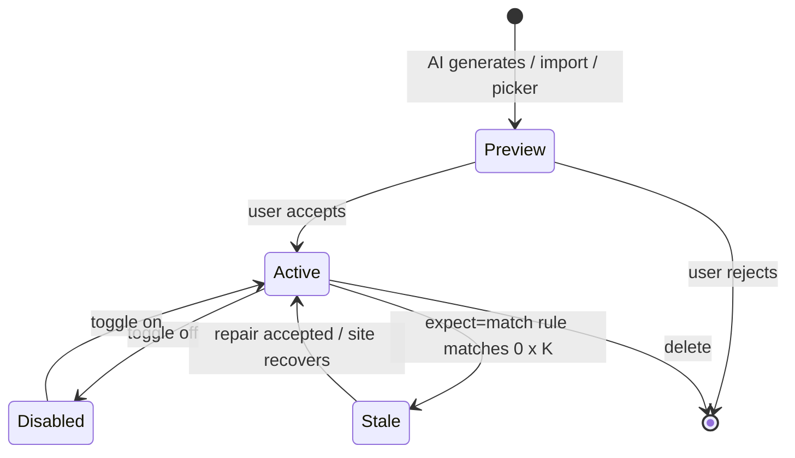

# Recipe Format

> **Status: Partially implemented.** The Rust validator and Worker implement schema v1, including optional multi-site `hub` metadata and per-rule `on` match scopes. Options and the implemented subset are described below; remaining fields are design notes. AI-generated hubs are saved only after explicit acceptance; see [AI Assistant](./ai-assistant.md#build-a-hub).

A **recipe** is a JSON document describing modifications for one or more URL patterns, optionally with a `hub` launcher spanning several sites. AI proposes data, Rust validates it, and the app applies it after user acceptance.

## Why declarative, not scripts

- **Safe for AI output.** A rule list can be schema-validated; arbitrary JS cannot.
- **Inspectable.** Users see "Hide: Reels tab" with a toggle, not a code blob.
- **Repairable.** When a site changes, a failed rule is identifiable and the AI can patch just that rule.
- **CSS-first.** Most rules compile to a stylesheet that applies before first paint, so removed things never flash.

A `script` rule is the escape hatch for what CSS cannot do. What it may do depends on who wrote it (see [Trust levels](#trust-levels)): anything, for the user's own assistant; a small default-deny subset that cannot send data anywhere, for recipes that come from outside ([Script Policy](./script-policy.md)).

## Shape

```json
{
  "schema": 1,
  "id": "instagram.no-reels",
  "name": "Instagram without Reels",
  "version": "1.0.0",
  "origin": "user",
  "tags": ["mobile"],
  "match": ["https://www.instagram.com/*"],
  "rules": [
    {
      "id": "nav-reels",
      "label": "Reels tab",
      "type": "hide",
      "target": { "ariaLabel": "Reels", "closest": "a" }
    },
    {
      "id": "reels-route",
      "label": "Redirect /reels to home",
      "type": "redirect",
      "when": { "path": "/reels/**" },
      "to": "/"
    }
  ]
}
```

### Top-level fields

| Field | Type | Notes |
|-------|------|-------|
| `schema` | integer | Format version. Unknown higher version → recipe refused, not guessed at. |
| `id` | string | Stable, `site.slug`. Unique per user. |
| `name` | string | Display name. |
| `version` | semver | Bumped by author/AI on change. |
| `origin` | `user` \| `ai` \| `imported` | Drives [trust level](#trust-levels). |
| `tags` | string[] | **Required (Design; Rust `schema.rs` and the Worker's `validate.ts` must stay equal).** Platform tags only: 1 or 2 unique values from `mobile`, `desktop`. A missing, empty, unknown or duplicate tag, or `official` / `community` inside the recipe, makes it invalid. See [Tags](#tags). |
| `match` | string[] | URL patterns (scheme + host + path glob). A recipe applies when any matches the top-level page URL. |
| `rules` | Rule[] | Ordered. Each independently toggleable. |
| `meta` | object | Optional: `author`, `summary` (one plain line, 1 to 140 characters, shown in the recipe library), `homepage`, `lastVerified` (date), `notes` (at most 4000 characters, the same cap in Rust and in the Worker; Markdown, see [Notes](#notes)). `homepage` must be an `http(s)` address; Settings uses it as the page a favorite of the recipe opens, and hides the star on a recipe without one. Every official recipe sets it, and it must itself match the recipe's `match` patterns (tested). |
| `hub` | object, optional | Tabbed launcher metadata: `{ "tabs": [{ "label": "Reddit", "url": "https://www.reddit.com/" }, ...] }`. Requires 2–6 distinct HTTPS addresses, labels up to 20 characters, and each tab URL must be covered by `match`. A hub opens each tab as its own site session; it does not merge inboxes or read site content. |
| `performance` | object, optional | What was measured to make this site open faster; see [Performance](#performance). `adBlock` (what the ad blocker does on this site) and `entry` (pages to open at the address the site would redirect them to). |
| `rules[].on` | string[], optional | Restricts a rule to a nonempty exact subset of this recipe's `match` patterns. Without it, the rule applies to every matching page. The compiler emits separate scoped bundles so rules for one hub site do not leak onto another. |

## Hub recipes

A hub is a normal signed recipe with an optional `hub.tabs` launcher and optional site-specific rules. Each tab's URL must be covered by the recipe's `match`; duplicate tab URLs are refused. The app opens each selected URL in an ordinary site session, retaining that site's own cookies and navigation. Hub tabs are launch links only: no unified inbox, cross-site scraping, or automated action.

The library marks a recipe with the `hub` tag exactly when it has `hub` metadata. The tag supplements (never replaces) platform and origin tags.

Rules may declare `on` with one or more exact `match` patterns. A rule without `on` remains global to the recipe; a scoped rule is compiled only for the listed pattern. Do not use host-specific shell logic to decide where a recipe rule applies.

**Bundled and imported recipes are reviewed before they are added.** A hub proposal generated by AI is also only a preview until the user accepts it.

## Performance

Sites differ in what makes them slow, so the knowledge of what to do about it is data in the site's recipe, never a branch in the engine, the shell or Rust (see [Architecture invariants](../../AGENTS.md)). Add a field here only for something measured on a real page, and say what was measured in `meta.notes`.

```json
"performance": {
  "adBlock": { "elementHiding": false },
  "entry": [{ "from": "https://www.youtube.com/", "to": "https://m.youtube.com/", "platform": "mobile" }]
}
```

Installed recipes are copies: a recipe that gains a `performance` field reaches a user who already added it through the library's update button, and a new one at once. Nothing changes silently.

### `adBlock`

`elementHiding: false` leaves the ad blocker's element-hiding rules (the `css-display-none` rules that hide ad slots and banners by selector) off on this site. Request blocking stays on. Those rules are what a page pays for on every load, and a site whose ads are posts in its own feed gets nothing from them. Measured on the iPhone 17 Pro Max simulator (release build, three runs each): Instagram's first contentful paint was 735 to 841 ms with every rule list, 557 to 615 ms without the element-hiding rules and 432 to 470 ms with no lists; YouTube and Reddit did not change measurably, so only add it where it was measured. `open_session` asks `Recipes::skips_element_hiding` and hands the native side the variant lists (`AdBlock::rule_lists_without_hiding`: each list's id plus `-net`, derived from the full list's file and cached beside it); the native side keeps both versions of a list in its store (`VARIANT_SUFFIX`), so switching between sites never recompiles. Switching ad blocking off and on in Settings keeps such a page on its variant lists on iOS (`SetContentRuleListsRequest.variants`, and `elementHiding` on the open request); on macOS the full lists apply to every page again until it is reopened, and Android has one list set for all pages.

### `entry`

A page the site always sends somewhere else before showing it. A phone asking for `https://www.youtube.com/` is answered with a redirect to `https://m.youtube.com/`: one more round trip and one more secure connection before the first byte of the page. When the app is asked to open exactly `from`, it opens `to`. On the iPhone 17 Pro Max simulator, `www.youtube.com` reached the first committed page in 0.92 to 0.99 s and `m.youtube.com` in 0.66 to 0.71 s (three runs each, alternated); the cost is the redirect, so it grows with a slower network.

| Field | Notes |
|-------|-------|
| `from`, `to` | `https` addresses without credentials, query or fragment, at most 200 characters, both covered by the recipe's `match`, both on one site (same registrable domain), different from each other. No chains: no `to` may be another entry's `from`, and no `from` may repeat. |
| `platform` | Optional `mobile` or `desktop`. A site answers a phone and a computer differently (the desktop site does not redirect to `m.`), so a redirect a phone gets is marked `mobile`. Without it the entry applies everywhere. |

It applies only to an exact address. A video, a profile or a link the reader followed is never rewritten, and a favorite keeps the address it was saved with. Every page the app opens on its own goes through `open_session`, which asks `Recipes::entry_for`, so the start page, a favorite, a hub tab and a typed address all benefit. `entry` is allowed in every origin: it can only point inside the recipe's own patterns and site. The Worker's validator (`openmedia-worker/src/validate.ts`) does not know `performance` yet, so a shared recipe that carries it is refused there until that file mirrors this section.

## Notes

`meta.notes` is Markdown, shown on the recipe review. The reader supports `#` headings, `-` and `1.` lists, paragraphs, `**bold**` and `` `code` `` (`src/features/library/parseMarkdown.ts`). Links, images and HTML are not part of it and show as literal text, and the review renders React elements only, never markup, so a sender cannot load or navigate anything. Notes may contain line feeds; every other control character is still refused. The review shows a faded preview and expands on tap. Write what was checked, then the live counts, then what was not verified.

## Tags

Platform tags on the recipe are `mobile`, `desktop`, or both. They are part of the recipe and shown alongside the library tags in the recipe library.

- **The origin tag (`official` or `community`) is never in the recipe.** The Worker adds it to the index entry; an upload cannot claim to be official.
- **The `hub` content tag is also library-only.** The library adds it exactly when the recipe has `hub` tab metadata, so multi-site launchers are identifiable without changing the recipe's platform tags.
- Recipes the app itself creates get the current platform tag before validation. Imported files must already carry their platform tags; files without them are refused.
- For official recipes the platform tags follow the fixtures: `desktop` when `recipes/fixtures/<site>/desktop-*.html` exists, `mobile` when any other fixture exists.

## Options (user-facing toggles)

A recipe may list `options`: the switches Settings shows for the site. Each rule points at one with `option`; the switch turns every rule that points at it on or off together. A rule with no `option` always applies.

```json
"options": [
  { "id": "reels", "label": "Hide Reels", "description": "The Reels tab and Reels in your feed.", "group": "content", "default": false }
],
"rules": [
  { "id": "reels-tab", "label": "Reels tab", "type": "hide", "option": "reels", "target": { "css": "div:has(> a[href=\"/reels/\"])" } }
]
```

| Field | Notes |
|-------|-------|
| `id` | Lowercase letters, digits and `-`. Unique in the recipe; it is the key under which the user's choice is saved, so renaming one resets that choice. |
| `label` | At most 60 characters. Phrase it so ON means hidden ("Hide Reels"). |
| `description` | At most 160 characters, one sentence. Say what else it hides if the selector is broader than the label. |
| `group` | `annoyance` or `content`. Orders the switches. |
| `default` | Whether the rules apply until the user chooses. **Policy for official recipes, enforced by a test: annoyances `true`, content `false`.** An annoyance is something that gets in the way (install prompts, pop-ups that block the page, scroll locks, ad slots); content is something the user may well want to see. |

Validation: at most 40 options; every option has at least one rule; every `option` a rule names exists. Settings live in `library.json` (`siteOptions`: recipe id, then option id, then a boolean or a choice id); an option with no saved value follows the recipe's current default, so shipping a new option needs no migration. Adding `options`, `option`, `choices` and `choice` is additive, so `schema` stays 1.

### Choice options (more than on or off)

A switch has two states. When a thing can be tamed rather than only removed (a media grid shown, blurred or hidden; counters shown or hidden; recommendations shown, dimmed or hidden), the option lists its states instead:

```json
"options": [
  { "id": "media", "label": "Pictures and videos", "description": "How thumbnails appear in feeds.", "group": "content",
    "choices": [ { "id": "show", "label": "Show" }, { "id": "blur", "label": "Blur" }, { "id": "hide", "label": "Hide" } ],
    "default": "show" }
],
"rules": [
  { "id": "media-blur", "label": "Blur thumbnails", "type": "css", "option": "media", "choice": ["blur"],
    "target": { "css": "ytm-thumbnail-view-model img" }, "declarations": { "filter": "blur(14px)" } },
  { "id": "media-hide", "label": "Hide thumbnails", "type": "hide", "option": "media", "choice": ["hide"],
    "target": { "css": "ytm-thumbnail-view-model" } }
]
```

| Field | Notes |
|-------|-------|
| `choices` | 2 to 4 entries `{ id, label }`. `id` is lowercase letters, digits and `-`, unique in the option; `label` is at most 24 characters. **The first choice is the untouched state**: no rule may list it, and it is what "off" means (a recipe installed into incognito starts there). |
| `default` | A choice id (a boolean for a switch, which has no `choices`). **Policy for official recipes, enforced by a test:** an `annoyance` choice option defaults to a choice other than the first (the nag is handled); a `content` one defaults to the first. |
| rule `choice` | Required on every rule of a choice option and forbidden on any other rule: a non-empty array of that option's choices after the first, each at most once. The rule applies when the saved choice is one of them (`["blur", "hide"]` for a rule that both states need). |

An unset option follows the recipe's `default`. A saved value the option no longer accepts (a recipe update renamed a choice, or a switch became a choice option) is ignored and the default applies, so a recipe change never breaks a saved library. Choose a new option `id` when changing the kind of an option. A switch is still the right control when the only sensible states are on and off. The assistant (see [AI Assistant](./ai-assistant.md)) can set a choice option through `existingOption` with `choice`, but only creates switches.

## Targets

A **target** finds elements without relying on obfuscated class names (Instagram, Facebook and X use hashed, rotating classes). Prefer stable semantics: ARIA labels, roles, link destinations, visible text.

| Field | Meaning |
|-------|---------|
| `css` | Candidate selector. Default `*`. Use for structural anchors (`nav`, `[role=tablist]`, `ytd-reel-shelf-renderer`). |
| `ariaLabel` | Exact or `{ "contains": "..." }` match on `aria-label`. |
| `role` | ARIA role or implicit role of candidate. |
| `href` | `{ "prefix": "/reels" }`, `{ "equals": ... }` or `{ "contains": ... }` on the `href` path (query ignored). |
| `text` | `{ "equals": "Reels" }`, `{ "contains": ... }`, `{ "regex": ... }` on visible text. Case-insensitive by default. |
| `has` | A nested target the candidate must contain (maps to `:has()`). |
| `closest` | After matching, act on the nearest ancestor matching this selector (find the link by its label, hide the whole nav item). |

All specified fields must match (AND). A rule may list several targets (OR) via `targets: [...]`.

Resolution order: engine picks candidates by `css`, filters by the semantic fields, then walks to `closest`. Pure-CSS targets (`css` + `has` + `href`/`ariaLabel` exact forms) compile to a stylesheet; anything needing text matching is evaluated by a throttled observer.

## Rule types (v1)

| Type | Effect | Notes |
|------|--------|-------|
| `hide` | `display: none !important` on matched elements | Reversible; element stays in DOM so site code doesn't break. **Default choice.** |
| `remove` | Detach matched elements from DOM | For when hidden elements still take effect (autoplay, layout). Can break site JS; use sparingly. |
| `css` | Inject a declarations block for a target or a global stylesheet | Whitelist of properties; no `url()`, `@import`, or `expression`. |
| `redirect` | If the page's path matches `when.path`, `location.replace` to `to` | `{ id, label, type: "redirect", option?, choice?, on?, when: { path }, to }`. Route guard (e.g. `/reels/**` → `/`). `when.path` is a glob on the pathname: `*` is any run inside one segment, `**` any run across `/`, a trailing `/**` also covers the bare prefix (`/reels/**` matches `/reels`, `/reels/` and `/reels/abc/def`), and a leading `!` negates it (`!/app/**` is every path outside `/app`). `to` is a path of the same site, with an optional query and fragment, that the glob does not itself select (`//host`, `https://…`, `javascript:` and a backslash are refused, so it can never leave the origin). Nothing from the recipe runs: the app's own runtime (`route_redirect.js`) evaluates it, so a shared recipe may carry one ([Trust levels](#trust-levels)). Runtime: [Site Runtime](./site-runtime.md#redirect-rules). |
| `media` | `{ "autoplay": "off", "loop": "off" }` etc. on `<video>` | Pause autoplay, stop looping. |
| `script` | Run JS in the page | `{ id, label, type: "script", option?, on?, code }`. `code` is a function body run once per page load after `DOMContentLoaded`, in strict mode. Origin decides what it may do, see [Trust levels](#trust-levels) and [Script Policy](./script-policy.md). Never run before the user has accepted the recipe. A script that installs a timer, observer or listener must register its teardown with `(window[Symbol.for('openmedia.cleanup')] ||= []).push(fn)`: the page script calls and empties that list each time it runs again, so switching the option off undoes the script in the live page |
| `videoMenu` | An option list of the site's own player (quality, captions, audio) in the app's video controls | `{ id, label, type: "videoMenu", option?, on?, kind: "quality"\|"captions"\|"audio"\|"other", title, open?: [{css}], items: {css}, selected: {attr}\|{class}, close?: {css} }`. No code: the app clicks `open` in order to open the site's menu, reads the entries `items` matches (their text is the label, `selected` says which is in use: one of `aria-checked`, `aria-selected`, `aria-current`, `data-checked`, `data-selected`, `data-active`, `data-state`, or a class), and picks one by clicking it (`video_menu.js`). It clicks the site's own controls, so a recipe with one cannot be imported, shared or in the community library (invariant 7); only the maintainers' official recipes (`recipes/official/`) and the user's own recipes may have one; at most 4 per recipe. The assistant counts the first `open` selector (else `items`) like a style rule's, so a menu with no way in is reported as matching nothing. |
| `prune` | Remove items from the JSON the page's own same-origin `fetch`/`XMLHttpRequest` calls receive | `{ id, label, type: "prune", option?, choice?, on?, urls: ["/api/feed"], remove: [{ path: "data.items[*]", when?: { key, equals } }] }`. Declarative; see [The prune rule](#the-prune-rule). Allowed in every origin, including shared recipes |
| `sponsorBlock` | Skip the segments the SponsorBlock service lists for the video on the page | `{ id, label, type: "sponsorBlock", option?, choice?, on?, videoId, categories }`. Official recipes only. See [Crowd rules](#the-sponsorblock-and-dislikecount-rules). |
| `dislikeCount` | Show the dislike count the Return YouTube Dislike service estimates | `{ id, label, type: "dislikeCount", option?, choice?, on?, videoId, target }`. Official recipes only. See [Crowd rules](#the-sponsorblock-and-dislikecount-rules). |
| `dark` | Fixes for the built-in dark mode of pages | `{ id, label, type: "dark", option?, choice?, on?, mode?: "on"\|"off", method?: "dynamic"\|"filter"\|"filterplus"\|"static", invert?: [selector] }`. At least one of `mode`, `method`, `invert`; at most 20 `invert` selectors. Declarative, so it may be shared and bundled. See [Dark Mode for Pages](./dark-mode.md#recipes-and-the-assistant). |

### The sponsorBlock and dislikeCount rules

`{ id, label, type: "sponsorBlock", option?, choice?, on?, videoId: { query: "v" }, categories: ["sponsor", "selfpromo"] }`
`{ id, label, type: "dislikeCount", option?, choice?, on?, videoId: { afterSegment: "shorts" }, target: { css: "dislike-button-view-model" } }`

The first skips, once each, the segments the public [SponsorBlock](https://sponsor.ajay.app) database lists for the video on the page (it is what the SponsorBlock browser extension does). The second writes the dislike count that [Return YouTube Dislike](https://returnyoutubedislike.com) estimates into the site's dislike button, which the site no longer shows (what that extension does). They are the only rules that make the app, rather than the site, contact a server. Runtime: `src-tauri/src/crowd_data.js`; validation: `recipes/crowd.rs`.

- **`videoId`**: where the page's own address holds the video id, exactly one of `query` (a parameter, `/watch?v=ID`) or `afterSegment` (the path segment after a fixed one, `/shorts/ID`). Names are 1 to 24 letters, digits, `-` or `_`. The runtime accepts only an id of 11 letters, digits, `-` or `_`; on any other page it sends nothing.
- **`categories`** (`sponsorBlock`): one or more of `sponsor`, `selfpromo`, `interaction`, `intro`, `outro`, `preview`, `filler`, each once.
- **`target`** (`dislikeCount`): a validated selector for the element that receives the count as a child `span`.
- **What is sent:** one GET per video, no cookies, no referrer, no custom headers. `sponsorBlock` goes to `sponsor.ajay.app` with the first four hex digits of the SHA-256 of the id (the service's k-anonymity scheme); `dislikeCount` goes to `returnyoutubedislikeapi.com` with the id itself, because that service has no hashed form. Both hosts are fixed in the runtime; a recipe cannot name another. The services also see the device's IP address.
- **Skipping:** only segments with action `skip`, once each per view of the video, so seeking back plays the segment. A video whose length differs from the one the segment was submitted for by more than 5 seconds (an ad in the same player) is left alone.
- **Limits:** 2 of these rules per recipe. Unknown fields are refused.
- **Trust:** **official recipes only.** An imported recipe (a bundled community recipe, a file import, a shared recipe) that carries one is refused, as with `videoMenu`. They ship off by default (`content`). See [Security](./security.md#crowd-rules).

### The prune rule

`{ id, label, type: "prune", option?, choice?, on?, urls: ["/api/feed", "/api/*/timeline"], remove: [{ path: "data.items[*]", when?: { key: "media_type", equals: 2 } }] }`

Removes items from the JSON that the page's **own** `fetch` and `XMLHttpRequest` calls receive, before the page's code reads it, so a feed's reels, suggested or sponsored items never reach the page (a `hide` rule leaves them loaded, autoplaying and counted). It is the web counterpart of the response filtering that Feurstagram does for Instagram's native app, and of the `json-prune` scriptlet in [Ad Blocking](./ad-blocking.md). Runtime: `src-tauri/src/prune_runtime.js`, delivered by the page script (see [Site Runtime](./site-runtime.md#prune-rules)).

- **`urls`** (1 to 8): paths on the page's own origin. Each starts with `/`, is ASCII, at most 120 characters, has at most 4 `*` (any run of characters), and carries no host, scheme, query (`?`) or fragment (`#`). A rule can therefore never name another origin; the runtime also requires the request URL and the final response URL to be on the page's origin. It matches `URL.pathname`, whole.
- **`remove`** (1 to 8 entries): `path` is a dot-separated list of keys, each optionally followed by `[*]` (every element of an array) or `[n]` (element `n`, 0 to 9999); a path may start with a selector for a response that is an array, has at most 16 steps and 200 characters, keys are `[A-Za-z0-9_$-]` up to 40 characters, and `__proto__`, `constructor` and `prototype` are refused. Nothing else: no filters, slices, recursive descent or expressions. The value the path reaches is deleted from its array or object. `when` is optional and the only condition: the value about to be removed must be an object that has the own property `key` strictly equal to the scalar `equals` (a string up to 80 plain characters, a number or a boolean). Examples: `data.items[*]`, `[*].node.tags[0]`, `edges[*].node.media[*]`, `data.suggested_users`.
- **Limits:** 8 `prune` rules per recipe. Unknown fields are refused. Control, zero-width and direction-override characters are refused everywhere.
- **Which responses:** only fully buffered bodies of at most 2 MiB, with a `Content-Type` that is JSON (or empty or `text/plain`) and a body that parses as a JSON object or array, for a successful (`ok`) response. A larger, chunked-past-the-cap, non-JSON, malformed or error response, a response whose shape does not hold the paths, and a response where nothing was removed, reach the page untouched. A streaming (chunked) body is therefore pruned only when it fits the cap once buffered; a longer-lived stream (server-sent events, NDJSON that never ends) is left alone.
- **Not covered:** requests made from Web Workers or service workers, `<script>`/``/`<video>` loads, navigations and form posts, requests that differ only by their body (`urls` match the path, never a body, which the runtime does not read), and a page that captured `fetch` before the script ran (Android's fallback injection can start late).
- **Off switch and reversibility:** the rule is on its `option` like every other; the page script is regenerated when a switch changes or a recipe is swapped and re-run in the live page, which replaces the active rules (none when the option is off). Wrapping happens once per page (a `Symbol.for('openmedia.prune')` guard); later runs only replace the rules, so toggling takes effect on the next response without a reload. The runtime switches itself off after 5 unexpected failures (the circuit breaker in [Site Runtime](./site-runtime.md#robustness-rules)).
- **Trust:** allowed for every origin, including bundled and shared recipes: it is data, starts no request, reads no request body and sends nothing. [Security](./security.md#prune-rules) has the argument; [Script Policy](./script-policy.md) explains why scripts still may not wrap `fetch`.
- The Worker's validator (`openmedia-worker/src/validate.ts`) must mirror this grammar and these limits before a recipe with a `prune` rule can be shared.

Deferred to later versions: `limit` (daily allowance by count/minutes, local counters), `scroll-stop` (cap infinite scroll), `text-replace`.

## Conditions

Any rule may carry `when`:

| Field | Meaning |
|-------|---------|
| `path` | Glob on `location.pathname` (`/reels/**`, `/`, `/watch`). Supports `!` negation. Implemented only inside a `redirect` rule (`when: { path }`, no other field); other rule types do not take `when` yet. |
| `viewport` | `mobile` \| `desktop` (the site often serves different DOM per width). |
| `loggedIn` | Not supported v1; sites differ too much. |

## Health

Each rule may declare `expect`: `"match"` (should match ≥1 element on pages satisfying `when`) or `"none"` (best-effort). The engine reports match counts to Core. A rule with `expect: "match"` that matches 0 on K consecutive eligible page loads is marked **stale** in the UI, and offers "Repair with AI" (re-snapshot, ask for a replacement for that rule only). Official recipes use this as their breakage detector in the field, with no telemetry: the state is local and shown to the user.

## Trust levels

| Origin | Allowed rule types | Apply policy |
|--------|--------------------|--------------|
| `user` (picker / manual) | all, `script` only in the shape check below | Applied immediately. The official recipe files in `recipes/official/` are written with `origin: "user"`; the app sets `imported` when it installs one. |
| `ai` | all; a `script` may do anything (no policy), but it must be one function body that cannot leave its wrapper | Shown as **preview** first (scripts are shown, not run); saved on user accept. The assistant never edits an installed recipe: it writes a separate `custom.<domain>` recipe beside it. |
| `imported` | `hide`, `css`, `redirect` (declarative, same-site only), `prune`, and `script` rules that pass the [Script Policy](./script-policy.md) | The recipes bundled in the app ([Recipe Library](./recipe-library.md)), and recipes added by earlier versions. Rust sets the origin itself, whatever the file says, runs the full policy on every script, and shows a rule-by-rule review (with the code) before anything is saved. See [Shared recipes](#shared-recipes). A `prune` rule is allowed because it is declarative and can only change what the page reads, see [The prune rule](#the-prune-rule). |
| `official` (library tag, **not an origin**) | `hide`, `css`, `redirect`, `prune`, `videoMenu`, `sponsorBlock`, `dislikeCount`, and any `script` | Official recipes are written by the maintainers and ship inside the app. They are parsed as `imported` (Rust sets the origin, validates the whole recipe and shows the rule-by-rule review) but are the one imported kind that is exempt from the script policy and may carry `videoMenu` and the crowd rules. The exemption follows the file's directory (`recipes/official/`, `market.official.` ids), never a claim inside the recipe. |
| any + `script` | `script` | The user accepts the recipe with the code and its list of powers shown (the assistant's proposal) or the code shown in the review (bundled recipes). Changing a script means a new proposal or a new version, which is reviewed again |

## Shared recipes

Implemented in `src-tauri/src/recipes/share.rs`. A recipe that arrives from outside the app (the bundled recipes, which come from pull requests) is the author's claim, so before the normal validation Rust:

- requires `tags` (platform tags only, see [Tags](#tags)); there is no migration for older files;
- ignores the file's `origin` and sets `imported` (so a file cannot claim `user` or `ai` to skip the script policy);
- accepts ids of lowercase letters, digits, `.` and `-` up to 80 characters, and a `version` of three numbers (`1.0.0`);
- refuses control characters and invisible direction overrides (U+200B–U+200F, U+202A–U+202E, U+2066–U+2069, U+FEFF) in the name, author, notes, option text and rule labels (notes may contain line feeds), and caps their lengths (name and author 60);
- refuses a `meta.homepage` that the recipe's own `match` patterns do not cover, because a favorite made from a recipe opens its homepage under the recipe's name;
- limits a recipe to 256 KiB and refuses duplicate ids. Only the bundled recipes may use `market.` ids (a legacy prefix kept so earlier installs keep working), and only `recipes/official/` may use `market.official.` ids ([Recipe Library](./recipe-library.md#the-library)).

There is no import or export of recipes as text.

## Validation (Rust, before anything reaches a webview)

- Parse with `serde` (`deny_unknown_fields`) → typed `Recipe`.
- Check `schema` version, id/rule-id uniqueness, `match` patterns well-formed and not overly broad (a bare `*` or `https://*/*` is refused for AI/imported recipes). Imported recipes are saved as `<app_data>/recipes/<id>.json` and listed with the others.
- Compile every selector with a safe-subset parser; reject selectors that are pathological (deep `:has()` nesting, huge unions).
- `css` rules: property whitelist, value sanitizer.
- `redirect`: `when.path` must be a well-formed glob (starts with `/` or `!/`, at most 200 characters and 4 wildcards, no space, control character, `?`, `#`, backslash or inner `!`), and `to` a same-site path (single leading `/`, at most 300 characters, no space, control character or backslash) that the glob does not select, so a rule cannot send a page to an address it redirects again (`src-tauri/src/recipes/route.rs`). The assistant cannot propose one ([AI Assistant](./ai-assistant.md)); the Worker's `validate.ts` must accept the same shape.
- Cap rule count (default 200) and recipe size.
- `script` rules: non-blank `code` of at most 16 384 bytes, at most 8 script rules and 32 768 bytes of code per recipe, no control, line-separator, zero-width or direction-override characters; `imported` recipes then pass the whole policy, other origins the shape check (`recipes/script_policy.rs`).

## Versioning and migration

- `schema` is the format version. Bump on breaking change; ship a Rust migration `vN → vN+1`; saved recipes are migrated on load and re-saved.
- `version` is the recipe's own semver.

## Lifecycle of a recipe



## Implemented subset

What the Rust code accepts today, validated with `deny_unknown_fields` so anything else is refused rather than ignored:

- Top level: `schema` (must be 1), `id`, `tags` (required; Design, see [Tags](#tags)), `name`, `version`, `origin`, `match`, `rules`, optional `meta` (`author`, `summary`, `homepage`, `lastVerified`, `notes`).
- Rules: `hide` (`display: none !important`), `css` (a whitelisted declarations block) and `script` (a function body, see above), `videoMenu` and `redirect` (`when.path` and `to`, see above). Targets are a single `css` selector; `ariaLabel`, `href`, `text`, `has`, `closest`, `expect`, `media` and `remove` are not accepted yet, and `when` only inside `redirect`.
- Selectors: at most 300 characters, no `{ } ; \ < @`, backtick or comments, balanced brackets, at most 20 selectors in a list and 2 `:has(`.
- `css` declarations: only `display`, `visibility`, `opacity`, `overflow`, `overflow-x`, `overflow-y`, `position`, `pointer-events`, `filter`, `height`, `min-height`, `max-height`, `touch-action`, `backdrop-filter`; values limited to letters, digits and ` .,%#()-`, no `url(`.
- `match`: `scheme://host/path` with `http`, `https` or `*`; the host may start with `*.` (matches the apex and any subdomain depth); `*` in the path is a glob. An all-sites or otherwise too broad pattern is refused for every recipe.
- Delivery: all recipes are compiled by Rust into one document-start script. The page tests its own `location` against each recipe's matcher regexes, so one script stays correct across navigations. The shell cannot open a page without it: `open_site` is the only way, and the plugin's `open` is not granted to the shell.
- Fixtures: every rule of a recipe in `recipes/official/` must match something in `recipes/fixtures/<site>/`; this is tested in Rust. A `redirect` rule has no element to match, so a fixture page declares the address it stands for with `<meta name="openmedia-fixture-url" content="https://…">` and the rule must fire on one such address (the recipe covers it and `when.path` selects its path). `youtube` (`/shorts/**`) and `instagram` (`/reels/**`) are the official recipes that use it.
- Options: `options[]` and a per-rule `option` (plus `choices[]` and a per-rule `choice` for multi-state options), as above. The page script is compiled per open and per toggle from the installed recipes and the saved choices (`Recipes::script`), and only enabled rules reach it.
- Limits that matter when writing selectors: the 300-character, 19-comma and 2-`:has(` limits apply to the whole `css` string of one rule, so an option with many selectors uses several rules.
- Official recipes (20, in `recipes/official/`, each with `origin: "user"`, `meta.author: "OpenMedia"` and tags from its fixtures): the sites people use most, each with many options. Some fixtures are **synthetic** or trimmed reconstructions and have not been verified against the live site; each recipe's `meta.notes` says what was checked. All are parsed and fixture-tested by `cargo test` and compiled into the app by `build.rs`; *Add* in the recipe library copies one into the user's recipes. Each carries a `meta.summary` (one line, up to 140 characters) for the library.
- Fixture rules: every rule matches something in its site's fixtures, and nothing a fixture marks `data-keep` (or an ancestor of it) may be hidden by a `hide` rule. Mark the login link, the feed container, the player and similar with `data-keep` when you add a fixture.
- Desktop and mobile: a site serves a different DOM to a desktop user agent (the Mac app) and to an iPhone one, so a recipe lists the rules for both under the same option and the family that is absent matches nothing; see [Site Playbooks](./site-playbooks.md#desktop-and-mobile-are-different-pages). Fixtures for desktop pages are named `desktop-*.html`. The fixture test reports every rule that matches nothing at once, not only the first.

## Inspirations

Cosmetic filters in content blockers (selector + `:has-text`-style predicates), userstyles, and userscript managers. The target model here is deliberately a small, validated subset of those.

## See Also

[Site Runtime](./site-runtime.md) · [AI Assistant](./ai-assistant.md) · [Security](./security.md)
