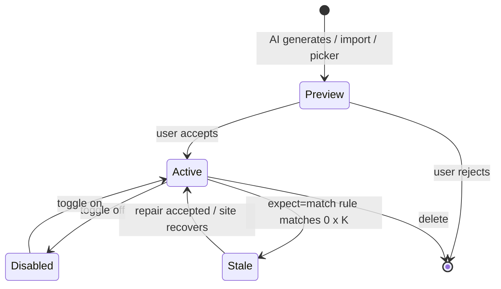

# Recipe Format

> **Status: Partially implemented.** Options (user-facing toggles) are implemented; see [Options](#options-user-facing-toggles). A subset of schema v1 is built in `src-tauri/src/recipes/` (see [Implemented subset](#implemented-subset)). Everything else below is still the intended design; the Rust types become the source of truth and this page follows them.

A **recipe** is a JSON document describing how to modify one site (or a set of URL patterns). The intended workflow is for AI to propose data, Rust to validate it, and the app to apply it; user editing, export, and sharing are future flows.

## Why declarative, not scripts

- **Safe for AI output.** A rule list can be schema-validated; arbitrary JS cannot.
- **Inspectable.** Users see "Hide: Reels tab" with a toggle, not a code blob.
- **Repairable.** When a site changes, a failed rule is identifiable and the AI can patch just that rule.
- **CSS-first.** Most rules compile to a stylesheet that applies before first paint, so removed things never flash.

A `script` rule exists as a gated escape hatch (see [Trust levels](#trust-levels)).

## Shape

```json
{
  "schema": 1,
  "id": "instagram.no-reels",
  "name": "Instagram without Reels",
  "version": "1.0.0",
  "origin": "bundled",
  "match": ["https://www.instagram.com/*"],
  "rules": [
    {
      "id": "nav-reels",
      "label": "Reels tab",
      "type": "hide",
      "target": { "ariaLabel": "Reels", "closest": "a" }
    },
    {
      "id": "reels-route",
      "label": "Redirect /reels to home",
      "type": "redirect",
      "when": { "path": "/reels/**" },
      "to": "/"
    }
  ]
}
```

### Top-level fields

| Field | Type | Notes |
|-------|------|-------|
| `schema` | integer | Format version. Unknown higher version → recipe refused, not guessed at. |
| `id` | string | Stable, `site.slug`. Unique per user. |
| `name` | string | Display name. |
| `version` | semver | Bumped by author/AI on change. |
| `origin` | `bundled` \| `user` \| `ai` \| `imported` | Drives [trust level](#trust-levels). |
| `match` | string[] | URL patterns (scheme + host + path glob). A recipe applies when any matches the top-level page URL. |
| `rules` | Rule[] | Ordered. Each independently toggleable. |
| `meta` | object | Optional: `author`, `homepage`, `lastVerified` (date), `notes`. `homepage` must be an `http(s)` address; Settings uses it as the page a favorite of the recipe opens, and hides the star on a recipe without one. Every bundled recipe sets it, and it must itself match the recipe's `match` patterns (tested). |
| `forkedFrom` | string | Only on a [fork](#forks): the bundled `version` the copy was made from. Rust sets it on save and refuses it on `bundled` recipes. |

## Options (user-facing toggles)

A recipe may list `options`: the switches Settings shows for the site. Each rule points at one with `option`; the switch turns every rule that points at it on or off together. A rule with no `option` always applies.

```json
"options": [
  { "id": "reels", "label": "Hide Reels", "description": "The Reels tab and Reels in your feed.", "group": "content", "default": false }
],
"rules": [
  { "id": "reels-tab", "label": "Reels tab", "type": "hide", "option": "reels", "target": { "css": "div:has(> a[href=\"/reels/\"])" } }
]
```

| Field | Notes |
|-------|-------|
| `id` | Lowercase letters, digits and `-`. Unique in the recipe; it is the key under which the user's choice is saved, so renaming one resets that choice. |
| `label` | At most 60 characters. Phrase it so ON means hidden ("Hide Reels"). |
| `description` | At most 160 characters, one sentence. Say what else it hides if the selector is broader than the label. |
| `group` | `annoyance` or `content`. Orders the switches. |
| `default` | Whether the rules apply until the user chooses. **Policy for bundled recipes, enforced by a test: annoyances `true`, content `false`.** An annoyance is something that gets in the way (install prompts, pop-ups that block the page, scroll locks, ad slots); content is something the user may well want to see. |

Validation: at most 30 options; every option has at least one rule; every `option` a rule names exists. Choices live in `library.json` (`siteOptions`: recipe id, then option id, then bool); an option with no saved choice follows the recipe's current default, so shipping a new option needs no migration. Adding `options` and `option` is additive, so `schema` stays 1.

## Targets

A **target** finds elements without relying on obfuscated class names (Instagram, Facebook and X use hashed, rotating classes). Prefer stable semantics: ARIA labels, roles, link destinations, visible text.

| Field | Meaning |
|-------|---------|
| `css` | Candidate selector. Default `*`. Use for structural anchors (`nav`, `[role=tablist]`, `ytd-reel-shelf-renderer`). |
| `ariaLabel` | Exact or `{ "contains": "..." }` match on `aria-label`. |
| `role` | ARIA role or implicit role of candidate. |
| `href` | `{ "prefix": "/reels" }`, `{ "equals": ... }` or `{ "contains": ... }` on the `href` path (query ignored). |
| `text` | `{ "equals": "Reels" }`, `{ "contains": ... }`, `{ "regex": ... }` on visible text. Case-insensitive by default. |
| `has` | A nested target the candidate must contain (maps to `:has()`). |
| `closest` | After matching, act on the nearest ancestor matching this selector (find the link by its label, hide the whole nav item). |

All specified fields must match (AND). A rule may list several targets (OR) via `targets: [...]`.

Resolution order: engine picks candidates by `css`, filters by the semantic fields, then walks to `closest`. Pure-CSS targets (`css` + `has` + `href`/`ariaLabel` exact forms) compile to a stylesheet; anything needing text matching is evaluated by a throttled observer.

## Rule types (v1)

| Type | Effect | Notes |
|------|--------|-------|
| `hide` | `display: none !important` on matched elements | Reversible; element stays in DOM so site code doesn't break. **Default choice.** |
| `remove` | Detach matched elements from DOM | For when hidden elements still take effect (autoplay, layout). Can break site JS; use sparingly. |
| `css` | Inject a declarations block for a target or a global stylesheet | Whitelist of properties; no `url()`, `@import`, or `expression`. |
| `redirect` | If current path matches `when.path`, navigate to `to` | Route guard (e.g. `/reels/**` → `/`). Same-origin only. |
| `media` | `{ "autoplay": "off", "loop": "off" }` etc. on `<video>` | Pause autoplay, stop looping. |
| `script` | Run JS in the page | **Gated.** Requires per-recipe user confirmation, never auto-applied. Never AI-applied silently. |

Deferred to later versions: `limit` (daily allowance by count/minutes, local counters), `scroll-stop` (cap infinite scroll), `text-replace`.

## Conditions

Any rule may carry `when`:

| Field | Meaning |
|-------|---------|
| `path` | Glob on `location.pathname` (`/reels/**`, `/`, `/watch`). Supports `!` negation. |
| `viewport` | `mobile` \| `desktop` (the site often serves different DOM per width). |
| `loggedIn` | Not supported v1; sites differ too much. |

## Health

Each rule may declare `expect`: `"match"` (should match ≥1 element on pages satisfying `when`) or `"none"` (best-effort). The engine reports match counts to Core. A rule with `expect: "match"` that matches 0 on K consecutive eligible page loads is marked **stale** in the UI, and offers "Repair with AI" (re-snapshot, ask for a replacement for that rule only). Bundled recipes use this as their breakage detector in the field, with no telemetry: the state is local and shown to the user.

## Trust levels

| Origin | Allowed rule types | Apply policy |
|--------|--------------------|--------------|
| `bundled` | all except `script` | Applied on enable. Shipped with and verified by the app build. |
| `user` (picker / manual) | all except `script` | Applied immediately. |
| `ai` | all except `script` | Shown as **preview** first; saved on user accept. |
| `imported` | all except `script` | Shown with a rule-by-rule review before first apply. |
| any + `script` | `script` | Per-recipe explicit confirmation with the code shown; confirmation stored keyed by a hash of the script. Changing the script re-prompts. |

## Validation (Rust, before anything reaches a webview)

- Parse with `serde` (`deny_unknown_fields`) → typed `Recipe`.
- Check `schema` version, id/rule-id uniqueness, `match` patterns well-formed and not overly broad (a bare `*` or `https://*/*` is refused for AI/imported recipes).
- Compile every selector with a safe-subset parser; reject selectors that are pathological (deep `:has()` nesting, huge unions).
- `css` rules: property whitelist, value sanitizer.
- `redirect`: same-origin target only.
- Cap rule count (default 200) and recipe size.

## Versioning and migration

- `schema` is the format version. Bump on breaking change; ship a Rust migration `vN → vN+1`; saved recipes are migrated on load and re-saved.
- `version` is the recipe's own semver. A fork records the bundled version it started from, so a newer bundled version can be told apart from the user's copy (see [Forks](#forks)).

## Forks

Fork persistence is implemented in Rust, but the user-facing fork workflow is not connected. `Recipes::save_fork` writes a validated customized copy under `<app_data>/recipes/<id>.json`, keyed to the bundled recipe id with `forkedFrom`; loading that file makes it replace the bundled recipe.

- **Updates:** a fork records the bundled version it came from. Automatic merging of newer bundled rules into a fork is not implemented.
- **Rust commands:** `save_recipe_fork` and `restore_recipe_original` are registered, but no shell UI calls them. AI acceptance currently saves through `Recipes::save_made`; it does not use the fork command.
- **UI:** editing/saving a fork and the restore-original action are not wired into Settings. The persistence functions and commands should not be mistaken for an available user flow.
- **Damaged files.** A fork file that is unreadable, invalid, not a fork, or for a recipe that is no longer bundled is ignored at startup; the bundled recipe applies.

## Lifecycle of a recipe



## Implemented subset

What the Rust code accepts today, validated with `deny_unknown_fields` so anything else is refused rather than ignored:

- Top level: `schema` (must be 1), `id`, `name`, `version`, `origin`, `match`, `rules`, optional `meta` (`author`, `lastVerified`, `notes`).
- Rules: `hide` (`display: none !important`) and `css` (a whitelisted declarations block). Targets are a single `css` selector; `ariaLabel`, `href`, `text`, `has`, `closest`, `when`, `expect`, `redirect`, `media`, `remove` and `script` are not accepted yet.
- Selectors: at most 300 characters, no `{ } ; \ < @`, backtick or comments, balanced brackets, at most 20 selectors in a list and 2 `:has(`.
- `css` declarations: only `display`, `visibility`, `opacity`, `overflow`, `overflow-x`, `overflow-y`, `position`, `pointer-events`, `filter`, `height`, `min-height`, `max-height`, `touch-action`, `backdrop-filter`; values limited to letters, digits and ` .,%#()-`, no `url(`.
- `match`: `scheme://host/path` with `http`, `https` or `*`; the host may start with `*.` (matches the apex and any subdomain depth); `*` in the path is a glob. An all-sites host (`*`) is refused unless the recipe is `bundled`.
- Delivery: all recipes are compiled by Rust into one document-start script. The page tests its own `location` against each recipe's matcher regexes, so one script stays correct across navigations. The shell cannot open a page without it: `open_site` is the only way, and the plugin's `open` is not granted to the shell.
- Fixtures: every bundled rule must match something in `recipes/fixtures/<site>/`; this is tested in Rust.
- Options: `options[]` and a per-rule `option`, as above. The page script is compiled per open and per toggle from the bundled recipes and the saved choices (`Recipes::script`), and only enabled rules reach it.
- Limits that matter when writing selectors: the 300-character, 19-comma and 2-`:has(` limits apply to the whole `css` string of one rule, so an option with many selectors uses several rules.
- Bundled today (18): `instagram`, `facebook`, `twitter`, `reddit`, `youtube`, `threads`, `telegram`, `douyin`, `messenger`, `discord`, `kuaishou`, `linkedin`, `whatsapp`, `snapchat`, `pinterest`, `weibo`, `tiktok` and `twitch`, each `<site>.default`. [Site Playbooks](./site-playbooks.md) records what each selector matched, how it was checked, and what CSS cannot do. Each recipe's `meta.notes` carries the same evidence next to the data.
- Fixture rules: every rule matches something in its site's fixtures, and nothing a fixture marks `data-keep` (or an ancestor of it) may be hidden by a `hide` rule. Mark the login link, the feed container, the player and similar with `data-keep` when you add a fixture.
- Desktop and mobile: a site serves a different DOM to a desktop user agent (the Mac app) and to an iPhone one, so a recipe lists the rules for both under the same option and the family that is absent matches nothing; see [Site Playbooks](./site-playbooks.md#desktop-and-mobile-are-different-pages). Fixtures for desktop pages are named `desktop-*.html`. The fixture test reports every rule that matches nothing at once, not only the first.

## Inspirations

Cosmetic filters in content blockers (selector + `:has-text`-style predicates), userstyles, and userscript managers. The target model here is deliberately a small, validated subset of those.

## See Also

[Site Runtime](./site-runtime.md) · [AI Assistant](./ai-assistant.md) · [Security](./security.md)
