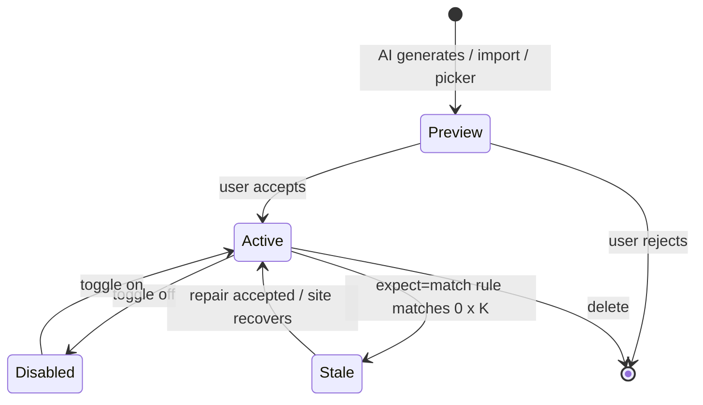

# Recipe Format

> **Status: Partially implemented.** The Rust validator and Worker implement schema v1, including optional multi-site `hub` metadata and per-rule `on` match scopes. Options and the implemented subset are described below; remaining fields are design notes. AI-generated hubs are saved only after explicit acceptance; see [AI Assistant](./ai-assistant.md#build-a-hub).

A **recipe** is a JSON document describing modifications for one or more URL patterns, optionally with a `hub` launcher spanning several sites. AI proposes data, Rust validates it, and the app applies it after user acceptance.

## Why declarative, not scripts

- **Safe for AI output.** A rule list can be schema-validated; arbitrary JS cannot.
- **Inspectable.** Users see "Hide: Reels tab" with a toggle, not a code blob.
- **Repairable.** When a site changes, a failed rule is identifiable and the AI can patch just that rule.
- **CSS-first.** Most rules compile to a stylesheet that applies before first paint, so removed things never flash.

A `script` rule exists as a gated escape hatch (see [Trust levels](#trust-levels)).

## Shape

```json
{
  "schema": 1,
  "id": "instagram.no-reels",
  "name": "Instagram without Reels",
  "version": "1.0.0",
  "origin": "user",
  "tags": ["mobile"],
  "match": ["https://www.instagram.com/*"],
  "rules": [
    {
      "id": "nav-reels",
      "label": "Reels tab",
      "type": "hide",
      "target": { "ariaLabel": "Reels", "closest": "a" }
    },
    {
      "id": "reels-route",
      "label": "Redirect /reels to home",
      "type": "redirect",
      "when": { "path": "/reels/**" },
      "to": "/"
    }
  ]
}
```

### Top-level fields

| Field | Type | Notes |
|-------|------|-------|
| `schema` | integer | Format version. Unknown higher version → recipe refused, not guessed at. |
| `id` | string | Stable, `site.slug`. Unique per user. |
| `name` | string | Display name. |
| `version` | semver | Bumped by author/AI on change. |
| `origin` | `user` \| `ai` \| `imported` | Drives [trust level](#trust-levels). |
| `tags` | string[] | **Required (Design; Rust `schema.rs` and the Worker's `validate.ts` must stay equal).** Platform tags only: 1 or 2 unique values from `mobile`, `desktop`. A missing, empty, unknown or duplicate tag, or `official` / `community` inside the recipe, makes it invalid. See [Tags](#tags). |
| `match` | string[] | URL patterns (scheme + host + path glob). A recipe applies when any matches the top-level page URL. |
| `rules` | Rule[] | Ordered. Each independently toggleable. |
| `meta` | object | Optional: `author`, `homepage`, `lastVerified` (date), `notes` (at most 4000 characters, the same cap in Rust and in the Worker; Markdown, see [Notes](#notes)). `homepage` must be an `http(s)` address; Settings uses it as the page a favorite of the recipe opens, and hides the star on a recipe without one. Every official recipe sets it, and it must itself match the recipe's `match` patterns (tested). |
| `hub` | object, optional | Tabbed launcher metadata: `{ "tabs": [{ "label": "Reddit", "url": "https://www.reddit.com/" }, ...] }`. Requires 2–6 distinct HTTPS addresses, labels up to 20 characters, and each tab URL must be covered by `match`. A hub opens each tab as its own site session; it does not merge inboxes or read site content. |
| `rules[].on` | string[], optional | Restricts a rule to a nonempty exact subset of this recipe's `match` patterns. Without it, the rule applies to every matching page. The compiler emits separate scoped bundles so rules for one hub site do not leak onto another. |

## Hub recipes

A hub is a normal signed recipe with an optional `hub.tabs` launcher and optional site-specific rules. Each tab's URL must be covered by the recipe's `match`; duplicate tab URLs are refused. The app opens each selected URL in an ordinary site session, retaining that site's own cookies and navigation. Hub tabs are launch links only: no unified inbox, cross-site scraping, or automated action.

The Worker accepts a `hub` catalog tag only when the recipe has `hub` metadata, and requires that tag for hub recipes. The tag supplements (never replaces) platform and origin tags.

Rules may declare `on` with one or more exact `match` patterns. A rule without `on` remains global to the recipe; a scoped rule is compiled only for the listed pattern. Do not use host-specific shell logic to decide where a recipe rule applies.

**Marketplace recipes are imported and reviewed before apply.** A hub proposal generated by AI is also only a preview until the user accepts it.

## Notes

`meta.notes` is Markdown, shown on the recipe review. The reader supports `#` headings, `-` and `1.` lists, paragraphs, `**bold**` and `` `code` `` (`src/features/marketplace/parseMarkdown.ts`). Links, images and HTML are not part of it and show as literal text, and the review renders React elements only, never markup, so a sender cannot load or navigate anything. Notes may contain line feeds; every other control character is still refused. The review shows a faded preview and expands on tap. Write what was checked, then the live counts, then what was not verified.

## Tags

Platform tags on the recipe are `mobile`, `desktop`, or both. They are hashed with the recipe and shown alongside catalog tags in the Marketplace.

- **The origin tag (`official` or `community`) is never in the recipe.** The Worker adds it to the index entry; an upload cannot claim to be official.
- **The `hub` content tag is also catalog-only.** The Worker adds it exactly when the recipe has `hub` tab metadata, so the signed catalog identifies multi-site launchers without changing the recipe's platform tags.
- Recipes the app itself creates get the current platform tag before validation. Imported files must already carry their platform tags; files without them are refused.
- For official recipes the platform tags follow the fixtures: `desktop` when `recipes/fixtures/<site>/desktop-*.html` exists, `mobile` when any other fixture exists.

## Options (user-facing toggles)

A recipe may list `options`: the switches Settings shows for the site. Each rule points at one with `option`; the switch turns every rule that points at it on or off together. A rule with no `option` always applies.

```json
"options": [
  { "id": "reels", "label": "Hide Reels", "description": "The Reels tab and Reels in your feed.", "group": "content", "default": false }
],
"rules": [
  { "id": "reels-tab", "label": "Reels tab", "type": "hide", "option": "reels", "target": { "css": "div:has(> a[href=\"/reels/\"])" } }
]
```

| Field | Notes |
|-------|-------|
| `id` | Lowercase letters, digits and `-`. Unique in the recipe; it is the key under which the user's choice is saved, so renaming one resets that choice. |
| `label` | At most 60 characters. Phrase it so ON means hidden ("Hide Reels"). |
| `description` | At most 160 characters, one sentence. Say what else it hides if the selector is broader than the label. |
| `group` | `annoyance` or `content`. Orders the switches. |
| `default` | Whether the rules apply until the user chooses. **Policy for official recipes, enforced by a test: annoyances `true`, content `false`.** An annoyance is something that gets in the way (install prompts, pop-ups that block the page, scroll locks, ad slots); content is something the user may well want to see. |

Validation: at most 30 options; every option has at least one rule; every `option` a rule names exists. Choices live in `library.json` (`siteOptions`: recipe id, then option id, then bool); an option with no saved choice follows the recipe's current default, so shipping a new option needs no migration. Adding `options` and `option` is additive, so `schema` stays 1.

## Targets

A **target** finds elements without relying on obfuscated class names (Instagram, Facebook and X use hashed, rotating classes). Prefer stable semantics: ARIA labels, roles, link destinations, visible text.

| Field | Meaning |
|-------|---------|
| `css` | Candidate selector. Default `*`. Use for structural anchors (`nav`, `[role=tablist]`, `ytd-reel-shelf-renderer`). |
| `ariaLabel` | Exact or `{ "contains": "..." }` match on `aria-label`. |
| `role` | ARIA role or implicit role of candidate. |
| `href` | `{ "prefix": "/reels" }`, `{ "equals": ... }` or `{ "contains": ... }` on the `href` path (query ignored). |
| `text` | `{ "equals": "Reels" }`, `{ "contains": ... }`, `{ "regex": ... }` on visible text. Case-insensitive by default. |
| `has` | A nested target the candidate must contain (maps to `:has()`). |
| `closest` | After matching, act on the nearest ancestor matching this selector (find the link by its label, hide the whole nav item). |

All specified fields must match (AND). A rule may list several targets (OR) via `targets: [...]`.

Resolution order: engine picks candidates by `css`, filters by the semantic fields, then walks to `closest`. Pure-CSS targets (`css` + `has` + `href`/`ariaLabel` exact forms) compile to a stylesheet; anything needing text matching is evaluated by a throttled observer.

## Rule types (v1)

| Type | Effect | Notes |
|------|--------|-------|
| `hide` | `display: none !important` on matched elements | Reversible; element stays in DOM so site code doesn't break. **Default choice.** |
| `remove` | Detach matched elements from DOM | For when hidden elements still take effect (autoplay, layout). Can break site JS; use sparingly. |
| `css` | Inject a declarations block for a target or a global stylesheet | Whitelist of properties; no `url()`, `@import`, or `expression`. |
| `redirect` | If current path matches `when.path`, navigate to `to` | Route guard (e.g. `/reels/**` → `/`). Same-origin only. |
| `media` | `{ "autoplay": "off", "loop": "off" }` etc. on `<video>` | Pause autoplay, stop looping. |
| `script` | Run JS in the page | **Gated.** Requires per-recipe user confirmation, never auto-applied. Never AI-applied silently. |

Deferred to later versions: `limit` (daily allowance by count/minutes, local counters), `scroll-stop` (cap infinite scroll), `text-replace`.

## Conditions

Any rule may carry `when`:

| Field | Meaning |
|-------|---------|
| `path` | Glob on `location.pathname` (`/reels/**`, `/`, `/watch`). Supports `!` negation. |
| `viewport` | `mobile` \| `desktop` (the site often serves different DOM per width). |
| `loggedIn` | Not supported v1; sites differ too much. |

## Health

Each rule may declare `expect`: `"match"` (should match ≥1 element on pages satisfying `when`) or `"none"` (best-effort). The engine reports match counts to Core. A rule with `expect: "match"` that matches 0 on K consecutive eligible page loads is marked **stale** in the UI, and offers "Repair with AI" (re-snapshot, ask for a replacement for that rule only). Official recipes use this as their breakage detector in the field, with no telemetry: the state is local and shown to the user.

## Trust levels

| Origin | Allowed rule types | Apply policy |
|--------|--------------------|--------------|
| `user` (picker / manual) | all except `script` | Applied immediately. The official recipe files in `recipes/official/` are written with `origin: "user"`; the app sets `imported` when it installs one. |
| `ai` | all except `script` | Shown as **preview** first; saved on user accept. The assistant never edits an installed recipe: it writes a separate `custom.<domain>` recipe beside it. |
| `imported` | `hide`, `css` | Pasted bundles and [marketplace](./marketplace.md) downloads. Rust sets the origin itself, whatever the file says, and shows a rule-by-rule review before anything is saved. See [Shared recipes](#shared-recipes). |
| `official` (marketplace tag, **not an origin**) | `hide`, `css` | **There is no `official` trust level.** Official recipes are published by us through the marketplace and arrive as `imported`: the same signature, hash, Rust validation and rule-by-rule review as a community recipe. A label does not grant trust. |
| any + `script` | `script` | Per-recipe explicit confirmation with the code shown; confirmation stored keyed by a hash of the script. Changing the script re-prompts. |

## Shared recipes

Implemented in `src-tauri/src/recipes/share.rs`. A recipe from outside the app is the sender's claim, so before the normal validation Rust:

- requires `tags` (platform tags only, see [Tags](#tags)); there is no migration for older files;
- ignores the file's `origin` and sets `imported` (so a file cannot claim `user` or `ai` to skip the `hide`/`css`-only restriction);
- moves the id under `imported.` for pasted files (`instagram.default` becomes `imported.instagram.default`, so it can never replace an installed marketplace recipe or a custom one). Only the verified catalog path may use `market.` ids, and only the official publishing path may use `market.official.` ids ([Marketplace](./marketplace.md#tags-official-and-community));
- accepts ids of lowercase letters, digits, `.` and `-` up to 80 characters, and a `version` of three numbers (`1.0.0`);
- refuses control characters and invisible direction overrides (U+200B–U+200F, U+202A–U+202E, U+2066–U+2069, U+FEFF) in the name, author, notes, option text and rule labels (notes may contain line feeds), and caps their lengths (name and author 60);
- refuses a `meta.homepage` that the recipe's own `match` patterns do not cover, because a favorite made from a recipe opens its homepage under the recipe's name;
- limits a bundle to 1 MiB and 20 recipes, a recipe to 256 KiB, and refuses duplicate ids.

A bundle is `{ "openmediaBundle": 1, "recipes": [ … ] }`. Export covers only recipes the user made, changed or imported, never switches, settings or keys, and **needs Pro** (checked in Rust only; see [Paywall](./paywall.md)). Import is free.

## Validation (Rust, before anything reaches a webview)

- Parse with `serde` (`deny_unknown_fields`) → typed `Recipe`.
- Check `schema` version, id/rule-id uniqueness, `match` patterns well-formed and not overly broad (a bare `*` or `https://*/*` is refused for AI/imported recipes). Imported recipes are saved as `<app_data>/recipes/<id>.json` and listed with the others.
- Compile every selector with a safe-subset parser; reject selectors that are pathological (deep `:has()` nesting, huge unions).
- `css` rules: property whitelist, value sanitizer.
- `redirect`: same-origin target only.
- Cap rule count (default 200) and recipe size.

## Versioning and migration

- `schema` is the format version. Bump on breaking change; ship a Rust migration `vN → vN+1`; saved recipes are migrated on load and re-saved.
- `version` is the recipe's own semver.

## Lifecycle of a recipe



## Implemented subset

What the Rust code accepts today, validated with `deny_unknown_fields` so anything else is refused rather than ignored:

- Top level: `schema` (must be 1), `id`, `tags` (required; Design, see [Tags](#tags)), `name`, `version`, `origin`, `match`, `rules`, optional `meta` (`author`, `lastVerified`, `notes`).
- Rules: `hide` (`display: none !important`) and `css` (a whitelisted declarations block). Targets are a single `css` selector; `ariaLabel`, `href`, `text`, `has`, `closest`, `when`, `expect`, `redirect`, `media`, `remove` and `script` are not accepted yet.
- Selectors: at most 300 characters, no `{ } ; \ < @`, backtick or comments, balanced brackets, at most 20 selectors in a list and 2 `:has(`.
- `css` declarations: only `display`, `visibility`, `opacity`, `overflow`, `overflow-x`, `overflow-y`, `position`, `pointer-events`, `filter`, `height`, `min-height`, `max-height`, `touch-action`, `backdrop-filter`; values limited to letters, digits and ` .,%#()-`, no `url(`.
- `match`: `scheme://host/path` with `http`, `https` or `*`; the host may start with `*.` (matches the apex and any subdomain depth); `*` in the path is a glob. An all-sites or otherwise too broad pattern is refused for every recipe.
- Delivery: all recipes are compiled by Rust into one document-start script. The page tests its own `location` against each recipe's matcher regexes, so one script stays correct across navigations. The shell cannot open a page without it: `open_site` is the only way, and the plugin's `open` is not granted to the shell.
- Fixtures: every rule of a recipe in `recipes/official/` must match something in `recipes/fixtures/<site>/`; this is tested in Rust.
- Options: `options[]` and a per-rule `option`, as above. The page script is compiled per open and per toggle from the installed recipes and the saved choices (`Recipes::script`), and only enabled rules reach it.
- Limits that matter when writing selectors: the 300-character, 19-comma and 2-`:has(` limits apply to the whole `css` string of one rule, so an option with many selectors uses several rules.
- Official recipes (18, in `recipes/official/`, each with `origin: "user"`, `meta.author: "OpenMedia"` and tags from its fixtures): `instagram`, `facebook`, `twitter`, `reddit`, `youtube`, `threads`, `telegram`, `douyin`, `messenger`, `discord`, `kuaishou`, `linkedin`, `whatsapp`, `snapchat`, `pinterest`, `weibo`, `tiktok` and `twitch`. They are validated and fixture-tested by `cargo test` but not compiled into the app: they are published to the marketplace as `market.official.<site>` (for example `market.official.youtube`) and installed from there; nothing in `recipes/official/` is embedded in the app. [Site Playbooks](./site-playbooks.md) records what each selector matched, how it was checked, and what CSS cannot do. Each recipe's `meta.notes` carries the same evidence next to the data.
- Fixture rules: every rule matches something in its site's fixtures, and nothing a fixture marks `data-keep` (or an ancestor of it) may be hidden by a `hide` rule. Mark the login link, the feed container, the player and similar with `data-keep` when you add a fixture.
- Desktop and mobile: a site serves a different DOM to a desktop user agent (the Mac app) and to an iPhone one, so a recipe lists the rules for both under the same option and the family that is absent matches nothing; see [Site Playbooks](./site-playbooks.md#desktop-and-mobile-are-different-pages). Fixtures for desktop pages are named `desktop-*.html`. The fixture test reports every rule that matches nothing at once, not only the first.

## Inspirations

Cosmetic filters in content blockers (selector + `:has-text`-style predicates), userstyles, and userscript managers. The target model here is deliberately a small, validated subset of those.

## See Also

[Site Runtime](./site-runtime.md) · [AI Assistant](./ai-assistant.md) · [Security](./security.md)
