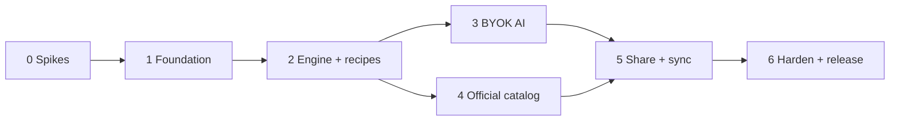

# Roadmap

> **Status: iOS implementation verified on simulators; Android implementation exists but device behavior and store release remain unverified; macOS site views exist and were run by hand on one Mac; Windows and Linux site views are not implemented.** The shell includes favorites, History, Usage, 18 site recipes (the official marketplace recipes, not embedded in the app), and an AI assistant with redacted preview and explicit acceptance. See [Platform Support](./platform-support.md) for evidence and limits.

## Goal

A Tauri v2 app (iOS and Android first; macOS, Windows, Linux after) where the user opens any site and reshapes it. Built-in official recipes cover popular sites; an AI assistant using the user's own key writes recipes for anything else. No backend.

## Principles

1. **Prove the risky parts first.** Mobile site view, the bridge, and key storage can each invalidate the architecture. They go before any UI polish.
2. **Vertical slice early.** "Hide Reels on Instagram, on macOS + iOS + Android, from a hardcoded recipe" before building the editor, the AI, or the catalog.
3. **No-AI path stands alone.** The built-in recipes and the picker must be useful without a key.
4. **Recipe format is the product.** Everything else is a way to author, apply, or repair recipes.

## Overview

Phases 3 and 4 are independent after Phase 2 and can run in parallel.

---

## Phase 0 — Feasibility spikes

Throwaway code in a `spikes/` branch/worktree (not merged to `main`); outputs are **recorded results** in [Platform Support](./platform-support.md), the decision log below, and updated wiki pages. Target: ~2 weeks.

| ID | Spike | Question answered | Pass criteria |
|----|-------|-------------------|---------------|
| S1 | Desktop site view (macOS) | Does `add_child` + `initialization_script` host Instagram and YouTube, log in, and inject at document start? | Logged-in Instagram web renders in a child webview; a hardcoded CSS rule hides the Reels nav item with no visible flash on cold load and on SPA navigation |
| S2 | The bridge | Can the engine send messages to Core without general IPC exposure? | Engine posts a message that Core receives; **a negative test proves a site view cannot invoke any other command**. Chosen option recorded in [Security](./security.md#the-bridge) |
| S3 | iOS native site view | Can an in-repo plugin host a `WKWebView` above the Tauri webview, positioned by a shell-reported rect? | Rect follows layout changes, rotation, keyboard; `WKUserScript` injection works; script message handler delivers to Rust |
| S4 | Android native site view | Same as S3 on Android; document-start injection support | Same pass criteria; document whether `addDocumentStartJavaScript` is available and what the fallback costs |
| S5 | Profile isolation | Separate cookie jars per profile on each platform | Log in as account A in profile 1; profile 2 is logged out. Record min OS versions and fallbacks |
| S6 | Secret store | Is there a backing that satisfies the invariants on desktop, iOS, Android? | Round-trip a test secret on all three; confirm not in plain files/backups; verdict: adopt plugin X or write thin in-repo plugin |
| S7 | LLM → rule feasibility | Given a pruned snapshot of real Instagram/YouTube pages, do current models produce usable targets? | Manual harness (not product code): ≥ 80% of 20 sample requests yield rules that match intended elements using stable semantics, not hashed classes. Informs snapshot format |

**Phase 0 exit (decision gate):**

- S1 + S2 + S3 pass → proceed as designed.
- S3 or S4 fails → evaluate alternatives before Phase 1: (a) different native-embedding approach, (b) ship desktop first, mobile later, (c) reconsider Tauri for mobile. **Stop and re-plan; do not push on.**
- S2 shows no safe desktop bridge → desktop adopts native-channel design (Bridge B equivalent).
- S7 fails → snapshot/prompt redesign before Phase 3; Phases 1–2 and 4 unaffected.

## Phase 1 — Foundation

Scaffold the real project and the guardrails.

- Tauri v2 + React/TS/Vite + Rust core scaffold; yarn; strict TS; clippy `-D warnings`.
- CI (`.github/workflows/ci.yml`) runs `lint`; the Husky pre-commit hook runs `format:check` and `test`. Type, Rust and Android checks run locally via `yarn verify`, `yarn test:android` and `cargo deny`.
- `SiteView` trait + desktop implementation + iOS/Android plugin skeletons from the spike learnings (rewritten cleanly, not copy-pasted spike code).
- The chosen bridge, with the negative-IPC integration test as a permanent regression test.
- Shell: one full-screen page, floating draggable button (tap: command bar, hold: favorites fan and settings), settings for favorites. See [UI Design](./ui-design.md).
- One hidden profile with its own isolated data store. Multiple profiles are deferred, not dropped.
- Settings/recipes persistence in app data dir.
- App icons: generate all platform icons from `assets/logo.svg` with `yarn tauri icon`. The source logo is not square and has wide margins, so first add a square, padded 1024×1024 master (e.g. `assets/icon-source.svg`) rather than editing `logo.svg`; check the result at small sizes and in the iOS rounded-mask and Android adaptive-icon safe zones.
- Flip [Development Guide](./development-guide.md), [Architecture](./architecture.md), [Platform Support](./platform-support.md) to `Implemented` where true.

**Exit:** open any URL on an iOS simulator and device; navigation works; the session persists; CI green. Android and desktop follow.

## Phase 2 — Engine and recipes

The vertical slice, then breadth.

- Recipe schema in Rust (`serde` + `schemars`), JSON Schema export, generated TS types, validator, migrations scaffold ([Recipe Format](./recipe-format.md)).
- Recipe store + URL resolution + merged bundle.
- Engine: CSS-first application, observer fallback, SPA navigation, `hide`/`remove`/`css`/`redirect`/`media`, reversibility, circuit breaker ([Site Runtime](./site-runtime.md)).
- Match reporting → rule health, stale detection.
- **First recipe.** Started with **Reddit without app prompts** because it is what the app hit first (see the decision log); it has DOM fixtures and a fixture test. Instagram without Reels is still to do. Done so far: the recipe schema subset, validation, the CSS compile and the document-start delivery, in `src-tauri/src/recipes/` (see [Recipe Format](./recipe-format.md#implemented-subset)).
- Customize panel: rule list, toggles, delete, undo.
- **Element picker** (no AI): tap element → proposed target → `hide` rule.
- Engine test harness: Playwright loads fixtures with the engine, asserts hidden/remaining sets.

**Exit:** on all three platforms, Instagram web shows no Reels tab and `/reels` redirects home, applied before first paint; user can toggle the rule, add a picker rule, and see staleness when a fixture simulates a site change.

## Phase 3 — BYOK AI assistant

- ~~`SecretStore` implementation per S6; key management UI (add, test, delete).~~ Done for iOS: trait plus `keyring` (v3, `apple-native`), a settings section to add, test and delete providers and keys. See [AI Assistant](./ai-assistant.md#implemented-provider-settings).
- **Implemented:** Anthropic and OpenAI-compatible adapters (including Gemini/OpenRouter presets), bounded DOM snapshots, Rust redaction, preview-before-send, validated patches with one correction attempt, page previews, match counts with up to two repair rounds, and explicit accept/reject. See [AI Assistant](./ai-assistant.md).
- **Implemented:** hub building from bounded read-only tools over the bundled recipes, with preview and explicit save/reject; sharing stays a separate action. See [AI Assistant](./ai-assistant.md#build-a-hub).
- Repair of stale rules.
- Error taxonomy in the UI; token estimate and size cap.
- Fixture-driven tests; recorded provider fixtures; redaction property tests.
- Manual evaluation script comparing providers on the fixture set.

**Exit:** with a user key, "remove the Reels tab and suggested posts" on a never-before-seen site yields a previewable recipe that the user can accept; invalid or zero-match output never silently applies; key never appears in any webview, log, or file (verified by test and by grep of app data after a run).

## Phase 4 — Official catalog (parallel with 3)

Curated, fixture-tested recipes. Order by value and breakability:

1. Instagram (Reels, Explore, suggested posts)
2. YouTube (Shorts shelf/tab, recommendations sidebar, autoplay)
3. X / Twitter (For You, trends, who-to-follow)
4. Facebook (Reels, Watch, Marketplace, suggested)
5. TikTok web (limited; feed is the product, so mostly cosmetic)
6. Reddit (popular/all, promoted, suggested communities)
7. LinkedIn (feed noise, promoted)
8. Snapchat web, Pinterest, Threads

Per site: recipe + scrubbed fixtures + fixture test + `lastVerified`. A "Recipes" browser in the shell with per-site toggles per rule, so users do not need to know recipes exist.

**Exit:** the catalog for sites 1–4 passes fixture tests; each rule shows human-readable labels and toggles; stale detection works on real drift.

## Phase 5 — Sharing and optional sync

Sharing without any server (file/text), plus sharing a recipe with everyone as a reviewed GitHub pull request opened by a small Worker ([Recipe Library and Sharing](./recipe-library.md)). Optional sync stays server-free.

- Export/import of recipes as text (removed 2026-11-13: recipes now ship in the app and are shared as pull requests).
- Recipe library: official and community recipes are compiled into the app; Add copies one to the user's recipes; Update when an app update brings a newer version; sharing is a pull request opened through a GitHub login, reviewed by maintainers, shipped in the next release. Replaced the 2026-11 marketplace.
- Recipe update flow: recipe updates reach the user in app releases; the assistant's recipe is a separate `custom.<domain>` one.
- Optional user-owned sync: sync recipe/settings folder to a user-provided git repo or file location. Never includes keys or cookies.
- Deferred recipe rule types: `scroll-stop`. Daily site allowances now live in Usage policies, not in recipes.

**Exit:** a recipe made on one device installs on another through export/import and through the community index, with the rule-by-rule review on the device.

## Phase 6 — Hardening and release

- Security review against [Security](./security.md); re-run IPC negative tests; dependency audit (`cargo audit`, `yarn audit`); `SECURITY.md`.
- Accessibility pass on the shell; i18n scaffolding (English first).
- Windows and Linux builds and per-platform workarounds.
- Signing and notarization (macOS), Windows signing, Android keystore, iOS provisioning; secrets in CI secret store only.
- Desktop auto-update via `tauri-plugin-updater` against GitHub Releases (static `latest.json`; updater private key held offline/in CI secrets).
- Store submissions (App Store, Play); privacy labels ("no data collected"; the snapshot goes to the user's chosen provider on explicit action, disclose it).
- Public README, screenshots, contribution guide for recipes.

**Exit:** signed builds on all platforms; store submissions accepted or feedback addressed.

---

## Decision log

| Date | Decision | Why | Revisit if |
|------|----------|-----|-----------|
| 2026-11-17 | The `redirect` rule type is implemented and allowed in shared and bundled recipes; the assistant still cannot write one | It is declarative (a glob and a same-site path, run by the app's own `route_redirect.js`), so it adds no code to review, and a route block needs it where hiding the links cannot stop a typed or shared address. Official `youtube` (`shorts`) and `instagram` (`reels`) use it | A redirect is used to mislead, or the Worker's `validate.ts` drifts from Rust |
| 2026-11-17 | A favorite may carry a `landing` address on its own registrable domain, used wherever a new session of it opens and at launch; stored on the favorite in `library.json` (format version unchanged: the field is optional and an older file loads as is) | The favorite's address is what identifies it (recipe, hub, live session, icon); the page it starts on is a separate, reversible choice. Same registrable domain only, so a session never leaves its domain (2026-11-07) | A favorite needs a different landing per profile or per platform |
| 2026-11-13 | **The recipe marketplace is removed.** All recipes ship inside the app (`recipes/official`, `recipes/community`); no catalog, signing, downloads, ratings, comments or install review. Sharing is a GitHub login through the Worker (scope `read:user` only) that opens a pull request with the Worker's own GitHub App token; maintainers review; the recipe reaches users in the next release ('available in the next update after review and approval'). Scripts stay allowed in recipes under the default-deny [Script Policy](./script-policy.md) (enforced in the Worker, CI and Rust); the assistant may write unrestricted scripts for the user's own recipes, shown with their code and powers and never run before accept. Supersedes the 2026-11-10 marketplace rows and 2026-11-07 'AI emits patches, never scripts' | Ordinary users need a simple, safe way to get and contribute recipes; a human-reviewed repository removes the unmoderated user-generated content, downloaded-code and server-cost risks of a live marketplace (Apple 2.5.2, UGC rules) | Recipes need to update faster than app releases (then use the OTA bundle channel, not a catalog); review capacity becomes the bottleneck |
| 2026-11-11 | Hubs are recipes with 2–6 independently opened site tabs; the AI may read the bundled recipes but only the user can accept/save a proposal, and publishing is a separate action | A unified inbox would require site-specific data access, credential handling and automation that conflicts with the app's customize-only boundary. Reusing the signed catalog and ordinary site sessions provides a safe launcher without scraping or merging accounts | Users ask for a real unified inbox; revisit only with an explicit product and privacy review |
| 2026-11-07 | Tauri v2 for desktop and mobile | User preference; one Rust core, one shell | S3/S4 fail |
| 2026-11-07 | Site view = separate native webview loading the real site; not iframe, not proxy | Frame-blocking headers; no backend; user logs in to real origin | — |
| 2026-11-07 | Mobile site view via in-repo native plugin (Swift/Kotlin) | `add_child` is desktop-only upstream | Upstream ships mobile multiwebview |
| 2026-11-07 | Declarative recipes; AI emits patches, never scripts (superseded for the user's own recipes, 2026-11-13) | Validatable, inspectable, repairable, safe | — |
| 2026-11-07 | LLM calls from Rust, key in OS secure store, never in webview | No CORS issue; key isolation | — |
| 2026-11-07 | Schema owned by Rust; TS generated | AI output arrives in Rust; one validator | — |
| 2026-11-07 | No push notifications, parent/family plans, or accounts | Require a backend | A backend decision is made |
| 2026-11-07 | Do not use Android Accessibility to block native apps | Policy and trust cost; out of scope | User demand |
| 2026-11-07 | Defaults: React, Zustand, Tailwind, yarn, Vitest, Playwright | Boring; yarn matches the author's other projects | Before Phase 1 only; cheap to change until the scaffold exists |
| 2026-11-07 | Recipes get `options`: named switches that group rules. Annoyances default on, content off. Choices are stored as overrides, keyed by recipe and option id | Users toggle "Reels" or "app prompts", not seven selectors; defaults can change in a release without a migration | A recipe needs per-rule choices |
| 2026-11-07 | Toggling a site option recompiles the document-start script and reloads the page (`set_document_start_script`) | Same mechanism as ad blocking; no live engine yet | The engine can apply `__om.update` without a reload |
| 2026-11-10 | Toggling a site option swaps the document-start script for the pages loaded next and runs the new script on the page showing now, with no reload or rebuild (`set_document_start_script` on iOS, Android and macOS); supersedes the 2026-11-07 reload. The macOS plugin swaps its own `WKUserScript` among the ones Tauri adds and rebuilds the view only if it cannot find it | A rebuild lost the scroll position and history on the Mac and a reload lost it on the phone, for a change of one stylesheet; the script already removes nothing and only appends one `style[data-openmedia]`, so removing that element and running the script again is exact | Frames inside the page keep the old script until they load again |
| 2026-11-08 | Favorites can be toggled from the current page, History or Settings; the first six remain quick access | Explicit user action adds a typed site without making browsing itself alter favorites; supersedes Settings-only favorites | — |
| 2026-11-08 | Incognito is a second favorites set and a second recipe-choice set, switched from the fan and locked by a biometric check (`.deviceOwnerAuthentication`); it is never persisted and is not cookie isolation | Asked for as a fast, private-looking alternate view; a passcode fallback keeps it usable without enrolled biometrics | Users expect real isolation (separate data store), or a fully biometrics-only policy is required |
| 2026-11-07 | Bottom margin is native (the site view rectangle), global with a per-site override resolved in Rust | CSS padding cannot move a page's own fixed bars off the screen edge | — |
| 2026-11-07 | iOS and Android are first-class; desktop deferred | Mobile is the product. S1 (desktop child webview) moves out of the critical path | Mobile is blocked, or desktop demand appears |
| 2026-11-07 | iOS 17 minimum | `WKWebsiteDataStore(forIdentifier:)` needs it; verified working on iOS 26.5 simulator | A non-isolated fallback is accepted |
| 2026-11-07 | Android requires `MULTI_PROFILE` and `WEB_MESSAGE_LISTENER`; no shared-profile fallback | A silent shared cookie jar breaks profile isolation. Kotlin now implements both checks; device verification remains open | A supported device cannot provide these features |
| 2026-11-07 | Bridge B on mobile: native message handler delivers into a Rust-created `Channel` | Verified on iOS: the page has no Tauri IPC, and Rust receives the message | Android verification fails |
| 2026-11-07 | Shell is one page with a floating button; no home screen, tabs, or address bar | User direction: the web is the product, controls stay out of the way | Users need several simultaneous tabs |
| 2026-11-07 | Site view sits below a transparent shell, with a native touch router | A control drawn in the shell cannot float over a native view that sits above it | The router breaks page scrolling or pinch on a device |
| 2026-11-07 | Android was deferred while the shell and single-profile UI settled | The original Kotlin implementation was removed at that point; a native Android implementation has since been restored and expanded. Device and store verification remain open | — |
| 2026-11-07 | Fix Reddit's "use the app" prompts with a bundled recipe (hide rules), not by changing the user agent | Site knowledge belongs in data; the wiki's risk register rules out UA spoofing. The web view's user agent has no `Safari` token, which sites can use to detect an embedded view; changing that is a separate, deliberate decision | Hiding is not enough for a site, or the user asks for a Safari-like user agent |
| 2026-11-07 | The shell opens pages only through the app's `open_site` command; the plugin's `open` is not granted to it | The recipe script is attached in Rust, so the shell cannot open a page without it | A second caller needs `open` |
| 2026-11-07 | The accent color follows the logo (cyan `#06aff8`), replacing the warm amber chosen earlier | The user asked for the logo to be used; amber clashed with it | The brand changes |
| 2026-11-07 | Provider keys live in the Keychain via `keyring` v3 (`apple-native`), behind an in-repo `SecretStore` trait; the shell never receives a key or a masked tail | Invariant 2; the third-party Tauri plugins are young. Verified on the simulator: save, `hasKey`, remove | Desktop or Android needs a different backing |
| 2026-11-07 | Several live sessions replace the one site view: a favorite switches to its session, a typed address always opens a new one, the shell closes hidden ones by idle time (20 min), count (5) and OS memory warning | The user did not want a page closed or reloaded by opening another. Per-page CPU and memory are not readable on iOS [INFERENCE], so the bounds are indirect | Real-device use shows the cap is too low or too high, or a measurable memory signal appears |
| 2026-11-07 | A session never leaves its registrable domain; outside links, `target=_blank` and `window.open` open in an `SFSafariViewController` popup | User rule. The system popup is out of process and shares nothing with the profile, so it adds no path to native code | Sites needing cross-domain sign-in inside the same view (the popup cannot hand cookies back) |
| 2026-11-07 | History is the typed addresses only, in `library.json` (format v4), cleared from Settings | User asked for searched sites. Favorite taps are not searches | Users want titles, times or per-entry delete |
| 2026-11-08 | Usage stats: foreground seconds per site and per first path segment, kept in their own `usage.json` (30 days), shown in a Stats sheet above History in the fan | User asked for screen-time awareness without any tracking. Sections come from generic path-segment code (no per-site cases, invariant 5); only names and seconds are stored; the shell passes its local date, which avoids a time-zone dependency in Rust | Users want per-page titles, exports, goals or limits; or sites whose areas are not in the path need recipe-supplied section names |
| 2026-11-08 | Favorites have no count limit; the first six are the quick-access menu. No stored flag: list order decides | User asked for unlimited favorites with six in the fan. A flag would need a format bump and a migration for lists already saved; order needs neither | Users want a favorite in the fan without moving it, or a different fan size |
| 2026-11-08 | Retain one reusable session per quick-access favorite once opened, exempt from routine idle eviction. Keep the base cap of 5 but expand only enough for these sessions and the active page (at most 7); memory warnings still release all hidden pages | Six quick-access sites could not fit the old five-session cap. Existing favorite matching and native activation already switch without reloading; keeping the sessions avoids repeated loads without speculative network traffic. Favorite edits reconcile retention immediately | Real-device memory or battery use is too high; consider selective preloading only after measuring retention |
| 2026-11-08 | Recipes carry `meta.homepage`; Settings adds or removes a recipe's favorite through `set_site_favorite` | Site knowledge stays in recipe data, not in the shell. Matching a favorite to a recipe uses the recipe's own `match` patterns, so `x.com` and `twitter.com` are one site | A recipe needs several entry pages |
| 2026-11-08 | Core opens the start page from `setup` and the shell adopts it (`boot.rs`, `adopt_boot_session`); the native `open` may run before the shell's view is in the window | The page does not depend on the shell, and opening it only after the shell booted put the page's web process, DNS and request behind the shell's whole startup. Earlier "pre-warm a `WKWebView`" found no process start to hide, which is a different thing: this overlaps two real loads | The shell needs the page's rectangle before the page may load (it does not today: `set_rect` corrects it), or a device shows the overlap slowing the shell's own start |
| 2026-11-08 | The splash waits for the page's first contentful paint (native `painted` flag), not for its address; the launch screen, the backdrop and the splash all show the logo | The address arrives at commit, long before a script-rendered page draws; hiding the splash then showed an empty screen | A site never reports a paint and the 4 s limit shows the backdrop too often |
| 2026-11-07 | Providers are `anthropic` or `openAiCompatible`; Gemini and OpenRouter are presets of the latter | One adapter covers hosted and local (Ollama, LM Studio) models, as in GitNotes | A vendor's structured output needs its native API |
| 2026-11-07 | Provider calls use `reqwest` with rustls, no redirects, HTTPS-only base URLs (HTTP only to this device) | A redirect can carry a custom auth header to another host; keys must never sit in a URL | |
| 2026-11-07 | Favicons are fetched natively from the site itself, not from an icon service | No third-party requests | Many sites return no usable icon and a fallback source is wanted |
| 2026-11-07 | The theme setting also sets the native site view's `overrideUserInterfaceStyle` | Sites that honor `prefers-color-scheme` follow the app's choice | Users want the app and sites to differ |
| 2026-11-07 | Dev builds use `debug = "line-tables-only"` | A full debug build of the iOS target filled a laptop disk | Full debuginfo is needed for a native debugger session |
| 2026-11-07 | Block ads and trackers with Brave's `adblock` crate (MPL-2.0) converting bundled EasyList and EasyPrivacy to WebKit content rule lists | Maintained (0.13.5 on 2026-10-28, ~1.4M downloads), Rust like the core, has a Safari content-blocking converter, blocks before a request leaves the device and before paint, no page JS. Lists are bundled so there is no new network destination | Android needs request interception instead; a list outgrows WebKit's 150,000-rule cap; a runtime list update is wanted (would need an invariant 1 change) |
| 2026-11-07 | One WebKit rule list per filter list (EasyList, EasyPrivacy), cached on disk by content hash and in WebKit's store by id | Each stays far below the cap (74,981 and 56,385 rules at the bundled versions); the multi-second compile runs once per list version | |
| 2026-11-07 | The converter's bare `if-domain`/`unless-domain` entries get a `*` prefix | Verified on macOS WebKit: a bare domain matches only that exact host, so `example.org##.ad` would not hide on `www.example.org` | The `adblock` crate emits the prefix itself |
| 2026-11-08 | Changes to a bundled recipe are saved as a **fork** (same id, `origin` user/ai, `forkedFrom` = bundled version) in `<app_data>/recipes/`, which replaces the bundled recipe while it exists | App updates replace bundled recipes; a user's or the assistant's changes must survive them. Same id keeps the saved switches and margin without a migration | Users want a newer bundled recipe merged into their copy, or several copies per site |
| 2026-11-08 | Usage extends Stats in the fan above History: any site can have optional daily warnings and limits, reset at local midnight | Reuses local foreground accounting; top warnings and native iOS blur shields stop loads, navigation, interaction and media for exhausted sessions only | Page JavaScript is not suspended |
| 2026-11-12 | A daily limit can also be set on one part of a site (a first path segment, such as Reels inside Instagram), stored next to the site's own limit. A part over its limit stops counting and says so; the site stays open, and the native shield is not used for a part | The seconds per site and per section were already stored, so the data was there. The native shield covers a whole session and refuses every navigation, so using it for a part would trap the user inside the part; closing a part natively needs per-path blocking in the site view plugin, which does not exist | Per-path blocking lands in the plugin, or the user wants the whole site closed when one part is over |
| 2026-11-08 | Quick-access sites get unread badges and local notifications read from the page title's leading `(N)`; notification text is app-owned, never page text; no push | User asked for notifications from quick-access sites like messages. The retained hidden sessions already report titles, so no page script, bridge message or backend is needed. Works only while iOS keeps the app and its web views running | A site needs counts the title lacks (a recipe-declared source), background delivery matters enough to revisit a backend, or Android lands |
| 2026-11-08 | Settings sections use closed-by-default native disclosures | Keeps long recipe, favorites and provider lists out of the initial screen | — |
| 2026-11-08 | The command bar uses the active BYOK provider rather than a hardcoded disconnected message | Existing assistant implementation reused, with redacted preview, validation and explicit acceptance; keys remain in Rust | — |
| 2026-11-08 | Paywall: AI, incognito and usage need a Pro entitlement; opening links, favorites, history, bundled recipes and ad blocking stay free. Lifetime $18.99, yearly $10, monthly $2 with a 14-day trial. Purchases and restore go through RevenueCat via an in-repo `tauri-plugin-billing` (StoreKit 2 on iOS, Play Billing on Android); the gate is enforced in Rust | User asked for monetization with no login. RevenueCat has no Tauri SDK, so the plugin wraps `purchases-ios` and `purchases-android`. Restore Purchases recovers the entitlement on a new device through the store account. This amends invariant 1: RevenueCat is the only third-party network destination besides user-chosen sites and providers | Desktop distribution needs a billing path; the store policy on gating a BYOK feature changes; RevenueCat is replaced |
| 2026-11-09 | macOS site views are Tauri child webviews under a transparent shell, with hit testing routed natively | Tauri has no z-order or hit-test pass-through, so the plugin keeps the shell above the pages, clears its background (private `drawsBackground`) and replaces `hitTest:` on the shell's view. S1 is answered for macOS; Windows and Linux are still open | Mac App Store review rejects the private key (then: a rail beside the page), or Tauri adds webview z-ordering |
| 2026-11-10 | *Superseded 2026-11-13: the marketplace was removed.* Recipe marketplace runs on Cloudflare (Workers + R2 + D1), curated, with an Ed25519-signed catalog. Signing key stays offline with the curator, public key compiled into the app, recipes pinned by SHA-256, monotonic sequence + expiry + revocation list. No `script` rules. Anonymous install counts, rate limited, display-only. File import forces `origin: imported` and the `imported.` id prefix | User asked for an in-app marketplace on Cloudflare for non-technical users, with install counts. This amends invariant 1 and security invariant 7: one optional OpenMedia server, untrusted by the app. A static GitHub index (the earlier plan) cannot take in-app submissions or counts. The Worker has no admin API and no signing key, so a compromised Cloudflare account can withhold recipes but not forge them | The store reviews object to user-submitted content, moderation load outgrows one curator, or counts prove too gameable to be useful |
| 2026-11-10 | *Superseded 2026-11-13: the marketplace was removed.* The marketplace publishes itself, and the row above is superseded. The Worker rejects a submission that fails its validation policy before any R2 or D1 write, holds every accepted one for 14 days in a public Upcoming feed (`releaseAt = submittedAt + 14 days`), and a scheduled Worker promotion publishes the matured entries and signs the catalog. The signing key becomes a Worker secret and the curator CLI is removed | The user asked for no manual approval and automatic publication, and one curator's review did not scale. The fixed 14-day hold keeps an accepted recipe publicly visible before it is published, so a report can arrive before it goes live. Moving the key into the Worker means a compromised Cloudflare account can forge entries, so the device's protection is the SHA-256 pin, the Rust validation and the rule-by-rule review, not the signature | The stores reject the design for the missing pre-publication filtering and user blocking (Apple 1.2, Play UGC), or a forged entry reaches a device |
| 2026-11-09 | Pro is decided by the store on the Mac too (StoreKit 2 through RevenueCat, a Swift package linked into the app) | The Mac forced Pro because the billing plugin had no desktop side; the paywall now applies there | Windows and Linux stay forced to Pro until they get a store |
| 2026-11-10 | The app is 1.0.0 and the three store packages come from one command (`yarn release`), which also raises the build number; the Mac ships as a sandboxed Mac App Store package | The App Store Connect version records were 1.0 and Play had already used versionCode 1000; Transporter takes only an `.ipa` or a signed `.pkg`, and StoreKit purchases need a Mac App Store build | A store rejects the sandbox build, or Play can be queried (then the Android build number can be looked up too) |
| 2026-11-10 | *Superseded 2026-11-13: the marketplace was removed.* **Marketplace v2 (Design; not deployed, verification pending the lead's final run).** (1) Every recipe carries platform tags `mobile`/`desktop` inside the recipe; the origin tag `official`/`community` is added by the Worker and never stored in a recipe, and a user upload can never be official. (2) The app ships **no bundled recipes and has no forks** (recipe origins are `user`, `ai`, `imported`; the assistant writes a separate `custom.<domain>` recipe beside an installed one): the 18 move to `recipes/official/`, are published as `market.official.<site>` through an operator SQL script, and onboarding installs the user's quick-access picks (4 free, 6 Pro) and explains the marketplace. (3) Ratings (1 to 5, one per identity, display-only, landing behind Turnstile, app via `X-Client: app` which can be scripted) and Pro-only comments (read by everyone). (4) Uploading and exporting need Pro: uploads and comments are verified by the Worker against RevenueCat (the app sends its RevenueCat app user id in `X-Pro-User`; the Worker stores only its SHA-256) and fail closed; deleting your own comment is not Pro-gated; export and the onboarding slot count are client-side only, and the RevenueCat id works as a bearer secret for Pro actions. (5) Required abuse rules: comment text, rate and duplicate limits, three reports from aged or Pro identities hide a comment, local commenter blocking, identity-age and per-identity rating caps, per-IP limiters on the IPv6 /64, a global budget of 60 RevenueCat lookups per minute. Operator takedown is editing D1; there is no public admin API | The user asked for official-versus-community recipes, quick-access onboarding, ratings and Pro-gated contribution. Official recipes through the marketplace keep one install path (signature, hash, Rust validation, rule review) and let recipe fixes ship without an app release. Pro verification must be server-side because an uploader controls the client. Cost of the decision: invariant 1 now has two identifiers (device token, RevenueCat id on Pro actions) reaching the marketplace, user-generated comments widen the store-policy risk with filtering, reporting and blocking only partly addressed and no human moderation, and a fresh install has no recipes until the user installs some | Either store rejects or asks for changes to UGC comments; abuse of the app rating path or comments outgrows the limits; RevenueCat's REST API limits, pricing or subscriber-creation behaviour break the Pro check; offline first-run without any recipe proves a bad default; revisit moderation (a person, or removing comments) if reports accumulate |

| 2026-11-12 | A window the page opens with `window.open` is a sign-in window inside the app, in the session's own profile and with the opener's link; the system popup stays for automatic cross-domain navigation | A system popup shares no cookies with the profile, so a sign-in that ran there could never hand its token back: the page stayed logged out and the popup showed a blank page. The in-app sign-in window was lost when the sessions merge landed on 2026-11-07; it is restored on iOS and added on Android, where the WebView has no `window.opener` and the plugin carries the message over a bridge | A third-party sign-in page runs inside the app with the profile's storage, and on mobile the window has no URL bar |

## Open questions

1. **Bridge mechanism** (S2): remote-capability command vs native channel on desktop.
2. **Secret store** (S6): decided for iOS (in-repo trait over the `keyring` crate, Keychain). Desktop and Android are open.
3. **Minimum iOS version**: decided, iOS 17. See the decision log.
4. **Do we support multiple tabs per profile on mobile in v1?** Memory and plugin complexity; start with one active site view plus a lightweight switcher.
5. **Licensing**: choose a license before opening to contributors (not yet decided).
6. **Monetization**: decided, see the 2026-11-08 paywall decision. Desktop billing is open.
7. **Official recipe maintenance**: who keeps Instagram's recipe alive when the site changes? Stale detection plus community PRs; define the contribution flow in Phase 5.

## Risk register

| Risk | Likelihood | Impact | Mitigation |
|------|-----------|--------|------------|
| Mobile native webview hosting is fragile (layout, gestures, lifecycle) | Medium | High | Phase 0 S3/S4 gate; keep plugin surface tiny |
| Sites change DOM and break recipes constantly | High | Medium | Semantic targets, health/stale detection, AI repair, fixtures, community PRs |
| Remote-origin IPC misconfiguration exposes native commands | Low (if tested) | Critical | Bridge design, negative integration test, pinned patched Tauri |
| LLM output quality varies across models | Medium | Medium | Structured output + validation + repair loop; S7; per-provider eval script |
| Snapshot leaks private content to provider | Medium | High | Two-pass redaction, preview default-on, local-model option, docs |
| App Store rejects as a web wrapper | Medium | High | Native functionality is real (profiles, picker, editor, AI); verify guidelines before submit [INFERENCE] |
| Site ToS enforcement / anti-bot challenges | Medium | Medium | Customize-only; no automation; no UA spoofing |
| "Sign in with Google" unavailable in embedded webviews | High for affected sites | Low–Medium | Document; handle via system-browser handoff later if needed |
| `unstable` Tauri feature changes between releases | Medium | Medium | Pin Tauri version; isolate behind `SiteView`; track upstream |
| Third-party secret-store plugin is unmaintained | Medium | High | Trait abstraction; thin in-repo option |
